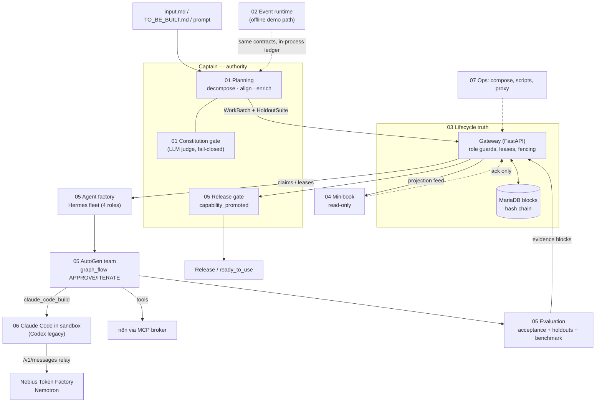
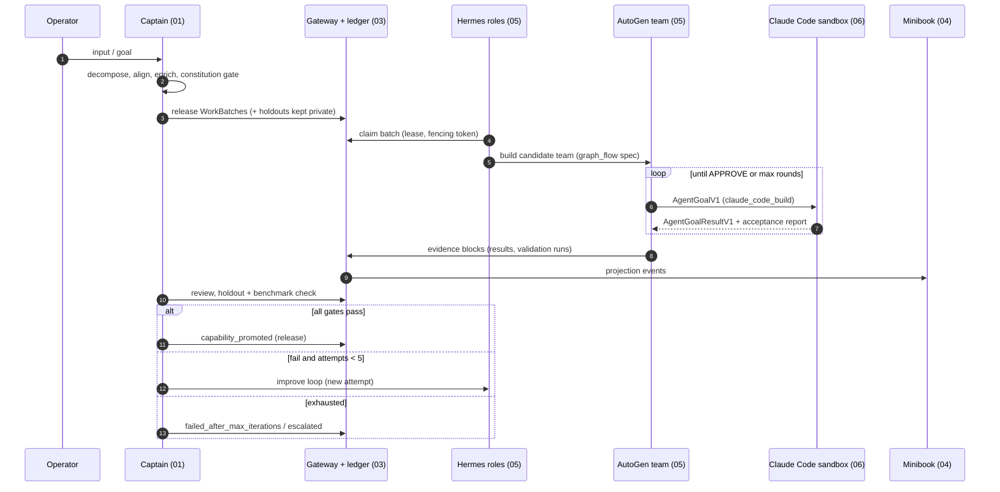

# Captain Cook architecture — high-level overview

Status snapshot: 2026-10-12, branch `feat/nebius-claude-sandbox` (HEAD `6ec2e0e`).
Derived from code, specs under `docs/superpowers/specs/`, plans under
`docs/superpowers/plans/`, and [`../ARCHITECTURE.md`](../ARCHITECTURE.md).
Where prose and code disagree, these documents follow the code and say so.

## 1. What the system is

Captain Cook is an auditable delivery orchestrator. A deterministic authority
(the **Captain**) turns an input into versioned work contracts, lets
constrained workers (Hermes roles, AutoGen teams, Claude Code in a sandbox)
produce candidates, records every lifecycle step in an append-only,
hash-chained ledger behind the **Gateway**, and is the only component allowed
to promote or release a result. Minibook is a read-only projection for humans.

Authority invariants that every part below respects:

| Invariant | Enforced in |
|---|---|
| Only Captain promotes/releases (`capability_promoted`, release gate) | Gateway role guards `gateway/app.py:207-256`, `gateway/capability_assembly_api.py` (`require_captain`); see [05](05-agent-factory.md), [03](03-ledger-gateway.md). `work_batch` release is role-gated but not review-gated (finding 1) |
| Production state changes only through the Gateway; MariaDB `blocks` is append-only and hash-chained | [03](03-ledger-gateway.md) |
| LLM output (decompose, align, enrich, judge, verdicts) is always re-validated by code; fail closed | [01](01-captain-planning.md), [02](02-event-runtime.md) |
| Holdout assertions never enter the generation context | [01](01-captain-planning.md), [05](05-agent-factory.md) |
| n8n executes integrations, never reasons or releases | [05](05-agent-factory.md), [07](07-operations-live-demo.md) |
| Minibook never issues commands; it only acknowledges projections | [04](04-delivery-minibook.md) |
| Coding agents (Codex today, Claude Code next) never release; secrets reach them only as child-process env or run tokens | [06](06-coding-execution.md) |

## 2. Parts

| # | Part | Main code | Lifecycle entity | Maturity |
|---|---|---|---|---|
| 01 | [Captain planning & constitution](01-captain-planning.md) | `agenten/planning/`, `agenten/constitution/`, `agenten/decomposition/`, `agenten/validation/` | Captain run (`CaptainRunState`), WorkBatch | implemented; review-before-release gap |
| 02 | [Event-driven runtime](02-event-runtime.md) | `agenten/events/`, `agenten/runtime/`, `agenten/spawning/`, `agenten/workers/`, `agenten/supervision/`, `agenten/orchestration/pipeline.py` | Subproblem stage (`Stage`) | implemented in-process (offline demo); AutoGen runtime partial |
| 03 | [Ledger, blockchain & gateway](03-ledger-gateway.md) | `blockchain/`, `agenten/ledger_bridge/`, `gateway/` | Block, batch claim/lease | implemented; event feed/cursors and recovery wiring partial |
| 04 | [Delivery lifecycle & Minibook](04-delivery-minibook.md) | `agenten/delivery/`, `agenten/review/`, `minibook/` | Gateway batch (pending_review → claimed → terminal); legacy TODO machine | implemented; projection coverage partial |
| 05 | [Agent factory, Hermes & AutoGen teams](05-agent-factory.md) | `agenten/agent_factory/`, `agenten/agent_runtime/`, `agenten/targets/`, `agenten/evaluation/` | Factory job, candidate team, Hermes lease | implemented core; goal-driven builder G1/G2 planned |
| 06 | [Coding execution (Codex → Claude Code)](06-coding-execution.md) | `agenten/execution/`, `agenten/coding_agent/`, `agenten/provider_proxy/`, `config/llm_provider.py` | AgentGoal (`AgentGoalV1` → `AgentGoalResultV1`) | M0 + M1a done; sandbox adapter, relay route, token issuer planned |
| 07 | [Operations & live demo](07-operations-live-demo.md) | `scripts/`, compose files, `agenten/agent_factory/live_demo_entrypoint.py` | Service stack (preflight → healthy → stop) | local stack implemented; capability operator blocked; hosting (D) planned |

## 3. Component map

## 4. End-to-end lifecycle (target)

Three nested iteration loops drive quality: Claude Code rounds inside one goal
([06](06-coding-execution.md)), graph_flow team rounds
([05](05-agent-factory.md)), and the Captain improve loop capped at 5
attempts ([05](05-agent-factory.md), [04](04-delivery-minibook.md)).

## 5. Cross-cutting findings (verified against code in iteration 2)

Collected from the part documents; details and evidence are there. Each item
was re-checked against code; verdicts in brackets.

1. **Release before review** [confirmed] — with a gateway configured,
   `AutonomousCaptainPlanner.run` releases batches before
   `CanonicalPlanPublisher.publish`; the payload carries no status, so the
   gateway default `pending` applies (`agenten/planning/autonomous.py:62-73`,
   `gateway/app.py:177`). `GATEWAY_APPROVAL_ENABLED` only enables `/approve`
   and never forces `pending_review` ([01 §5](01-captain-planning.md)).
2. **Escalation dead end** [confirmed] — the supervisor publishes
   `EscalateToRedecompose`, but the in-process recorder has no handler, so an
   exhausted subproblem stays in RETRYING (`agenten/ledger_bridge/recorder.py:118-129`,
   `agenten/supervision/supervisor.py:154-172`). `SubproblemUnroutable` now
   ends in terminal FAILED with `unroutable_capability_tags` metadata — a
   terminal stage, not a separate dead-letter record
   ([02 §5](02-event-runtime.md)).
3. **Repair ceiling** [partly] — gateway (`gateway/contracts.py:1214`),
   delivery TODO model and factory job builder use 5; the agent-runtime
   control plane takes `max_iterations` per request (1–10). The 07-17
   gateway-native delivery spec says 3
   ([03](03-ledger-gateway.md), [04](04-delivery-minibook.md)).
4. **Terminal vocabularies diverge** — `batch_done` outcomes, factory terminal
   states, release decisions and control-plane verdicts use different names
   ([01](01-captain-planning.md), [03](03-ledger-gateway.md), [04](04-delivery-minibook.md)).
5. **Projection gaps** — Minibook feed emits 3 of 10 catalog types;
   `hermes_tool_gap_recorded` is accepted but never emitted
   ([04](04-delivery-minibook.md), [05](05-agent-factory.md)).
6. **Recovery wiring** [confirmed] — `recover_on_startup` and `verify_chain`
   have no non-test callers ([03](03-ledger-gateway.md)).
   **Stranded-batch bug** [confirmed, liveness]: `project_batch` never resets
   `recovery_recorded` on a new `batch_claimed`
   (`gateway/contracts.py:1119-1133`, `:1220`). After one requeue, an expired
   second claim stays `claimed`: re-claim and Captain recovery both get 409,
   and `RecoveryWorker` scans only `pending`. Fix: reset on claim, or compare
   `recovered_iteration == claim_iteration` as
   `agenten/delivery/recovery.py:81-82` already does. The existing test
   (`tests/gateway/test_gateway.py:1217`) stops before the second expiry
   ([04](04-delivery-minibook.md)).
7. **Lease/heartbeat mismatch** [confirmed] — a gateway heartbeat overwrites
   expiry with now + 30 min (`gateway/store.py:6694`) while the claim TTL is
   90 min, so the first heartbeat shortens the lease; the event runtime only
   stamps `last_heartbeat_at` and never extends
   ([03](03-ledger-gateway.md), [02](02-event-runtime.md)).
8. **Coding path not wired** [confirmed] — `agenten/coding_agent/` is
   referenced only by itself and `tests/coding_agent/`; relay route, sandbox
   adapter, run-token issuer pending ([06](06-coding-execution.md)).
9. **Live capability demo blocked** [understated in iteration 1] —
   `gateway.capability_assembly_bootstrap` is missing, so `run`/`resume` exit 2;
   `start` and `status` additionally hit an unconditional
   `DemoConfigurationError` (`agenten/demo_orchestrator/cli.py:59-67`), so
   adding the module alone would not unblock them
   ([07](07-operations-live-demo.md)).
10. **Ownership/ports drift** [confirmed] — a Captain-owned n8n stack runs on
    5679 (`docker-compose.captain-n8n.yml`), plus an `owned-n8n` profile on 5678
    in `docker-compose.yml`, contradicting AGENTS.md ("Captain-owned services
    are Mailpit and MariaDB"); Mailpit (8025 vs 18025) and Minibook (8080 vs
    3456) defaults disagree ([07](07-operations-live-demo.md)).
11. **Input contract drift** [confirmed] — `input_document.py:27-38` requires
    10 sections; the root `TO_BE_BUILT.md` (a sales playbook) has none of
    them; the runbook still names `input.md`
    ([01](01-captain-planning.md), [05](05-agent-factory.md)).
12. **Hardening note** [unverified as exploit] — generic `POST /blocks` lets a
    worker with a live claim store an `agent_factory_block` under a
    `work_batch` parent. Promotion queries ignore it (they join on an
    `agent_factory_job` parent), but nothing rejects it
    ([03](03-ledger-gateway.md)).

Actionable follow-ups are tracked as checkboxes in
[`2026-10-12-architecture-doc-findings.md`](../superpowers/plans/2026-10-12-architecture-doc-findings.md).

## 6. Reading order

New contributors: this page → [01](01-captain-planning.md) →
[03](03-ledger-gateway.md) → [05](05-agent-factory.md) →
[06](06-coding-execution.md). The [02](02-event-runtime.md) runtime is the
offline demo path; [04](04-delivery-minibook.md) and
[07](07-operations-live-demo.md) cover delivery projection and operations.
