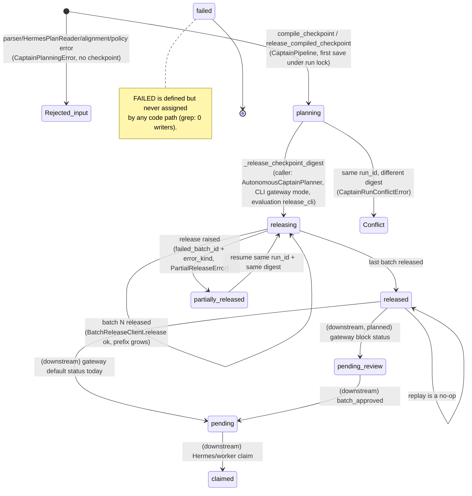
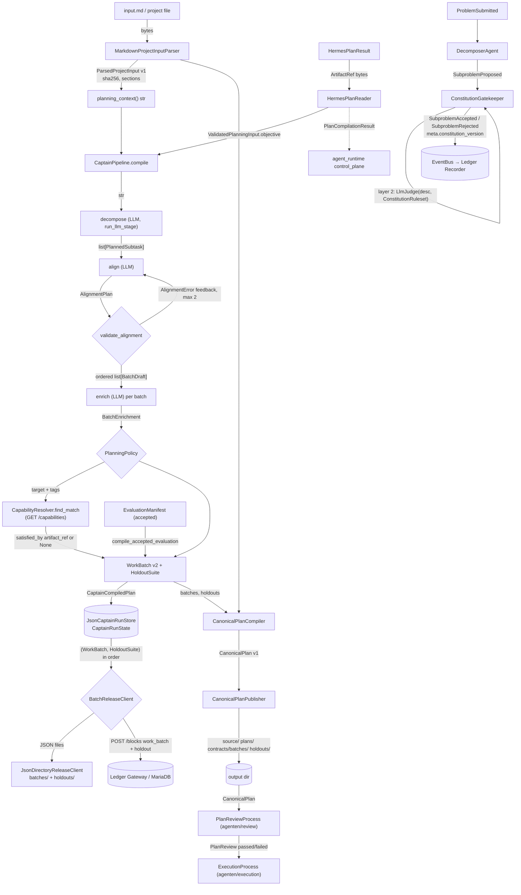

# 01 — Captain planning & constitution

Part of the [architecture overview](00-overview.md).

Status: descriptive, verified against branch `feat/nebius-claude-sandbox`
(2026-10-12). Where code and prose disagree, **code wins** and the
disagreement is listed in [§5](#5-implemented-vs-planned) and
[§5.1](#51-spec--code-contradictions).

## 1. Purpose & authority

This part turns a human problem statement into immutable, versioned work
contracts and decides whether proposed work is admissible. It covers four
in-repo paths that share contracts but are wired separately:

| Path | Input | Output |
| --- | --- | --- |
| A. Batch planner (`captain-plan`) | UTF-8 Markdown (`input.md` or any file) | `WorkBatch` + `HoldoutSuite` per batch, `CanonicalPlan` tree |
| B. Hermes-plan compile | `HermesPlanResult` (digest-verified artifacts) | `PlanCompilationResult` for the agent-runtime control plane |
| C. Evaluation bridge | accepted `EvaluationManifest` | `CaptainCompiledPlan` released through a run checkpoint |
| D. Supply-chain constitution | `ProblemSubmitted` event (free text) | `SubproblemProposed` → `SubproblemAccepted` / `SubproblemRejected` |

`TO_BE_BUILT.md` ingestion (`FactoryInputDocumentV2` → `CompiledFactorySpecification`)
and the ready-to-use release decision live under `agenten/agent_factory/` and
are documented in [05 — Agent factory](05-agent-factory.md); they are referenced here only as
interfaces.

**Captain decides:** subtask coverage and batch DAG validity, allowed targets
and capability tags, acceptance assertions, holdout custody (hidden cases are
never in a `WorkBatch`), capability reuse (`satisfied_by`), idempotent release
order, constitution admission (`constitution_version` stamped on every verdict).

**Captain planning must never:** execute or self-review a plan
(`AutonomousCaptainPlanner` docstring, `autonomous.py:26`); let an LLM decide
correctness (LLM output is always re-validated deterministically:
`alignment.py`, `policy.py`, `validators.py`); expose holdout payloads to
builders (`HoldoutSuite` is a separate model, `validation/contracts.py:93`);
release under a reused run id with different input (`CaptainRunConflictError`);
admit a subproblem when the LLM judge times out or raises
(`gatekeeper.py:148-158`); claim build or review evidence
(`reports/latest-build.md` is written as "not executed",
`canonical_plan.py:284-291`).

## 2. Components

| Module | Responsibility | Key types / functions |
| --- | --- | --- |
| [`agenten/planning/input_parser.py`](../../agenten/planning/input_parser.py) | Pure Markdown read: exact bytes, SHA-256, safe logical name, heading outline (fence-aware) | `MarkdownProjectInputParser.parse`, `ParsedProjectInput` (`captain-project-input/v1`), `MarkdownSection`, `planning_context()` |
| [`agenten/planning/captain_pipeline.py`](../../agenten/planning/captain_pipeline.py) | Decompose → align (retry with feedback) → enrich → policy → `WorkBatch`/`HoldoutSuite`; checkpointed, resumable release | `CaptainPipeline.compile`, `compile_from_plan`, `compile_from_hermes_result`, `compile_checkpoint`, `release_checkpoint`, `release_compiled_checkpoint`, `release`; `PlannedSubtask`, `BatchEnrichment`, `CaptainCompiledPlan`, `PlanCompilationResult`; ports `BatchReleaseClient`, `CapabilityResolver`, `HermesPlanResultReader` |
| [`agenten/planning/alignment.py`](../../agenten/planning/alignment.py) | Deterministic check of LLM batch grouping: every subtask exactly once, known deps, no cycle; stable topo order | `validate_alignment`, `AlignmentPlan`, `BatchDraft`, `AlignmentError` |
| [`agenten/planning/policy.py`](../../agenten/planning/policy.py) | Capability-tag allowlist; golden/holdout content-fingerprint isolation per batch and per run | `PlanningPolicy.validate_enrichment`, `validate_run_isolation`, `fingerprint_case` |
| [`agenten/validation/contracts.py`](../../agenten/validation/contracts.py) | Captain-owned execution contracts | `WorkBatch` (`captain-work-batch/v2`), `HoldoutSuite`, `AcceptanceAssertion`, `AssertionKind`, `ExampleCase` |
| [`agenten/planning/canonical_contracts.py`](../../agenten/planning/canonical_contracts.py) | Cross-process plan contract consumed by review/execution | `CanonicalPlan` (`captain-canonical-plan/v1`), `CanonicalWorkPackage`, `WorkPackageStatus` (`planned`/`reused`) |
| [`agenten/planning/canonical_plan.py`](../../agenten/planning/canonical_plan.py) | Stable topo order, round-robin worker pool (default 5), content-derived `plan_id`; atomic source+plans+contracts+holdouts tree | `CanonicalPlanCompiler.compile`, `CanonicalPlanPublisher.publish`, `PlanPublishConflictError` |
| [`agenten/planning/run_models.py`](../../agenten/planning/run_models.py), [`run_store.py`](../../agenten/planning/run_store.py) | Durable run checkpoint; released ids must be a dependency-ordered prefix | `CaptainRunState`, `CaptainRunStatus`, `PartialReleaseError`, `CaptainRunConflictError`, `JsonCaptainRunStore` (atomic `os.replace` + file lock) |
| [`agenten/planning/release.py`](../../agenten/planning/release.py) | Offline release adapter; holdout written before batch; idempotent replay, conflict on change | `JsonDirectoryReleaseClient`, `ReleaseConflictError` |
| [`agenten/planning/gateway_client.py`](../../agenten/planning/gateway_client.py) | Gateway release (`work_batch` block + child `holdout` block) and capability lookup | `GatewayPlanningClient.release`, `find_match`, `GatewayPlanningError` |
| [`agenten/planning/hermes_plan.py`](../../agenten/planning/hermes_plan.py) | Validates Hermes planning artifacts: digests, schema, project/correlation/version/planner match, secret & abs-path scan, integration intents | `HermesPlanReader.read`, `HermesPlanningDocument`, `ValidatedPlanningInput`, `HermesPlanningError` |
| [`agenten/planning/evaluation_bridge.py`](../../agenten/planning/evaluation_bridge.py) | Accepted QA evaluation → deterministic batch DAG (no LLM-inferred capability) | `compile_accepted_evaluation`, `release_accepted_evaluation`, `EvaluationBridgePolicy` |
| [`agenten/planning/autonomous.py`](../../agenten/planning/autonomous.py), [`factory.py`](../../agenten/planning/factory.py), [`cli.py`](../../agenten/planning/cli.py) | Application service, composition root (LLM stages wrapped by `run_llm_stage`), CLI `captain-plan` (`--release-mode json\|gateway`, `--run-id`) | `AutonomousCaptainPlanner.run`, `build_captain_pipeline`, `async_main` |
| [`agenten/constitution/ruleset.py`](../../agenten/constitution/ruleset.py) + [`default_constitution.yaml`](../../agenten/constitution/default_constitution.yaml) | Versioned ruleset (`v1-default`): scope, rubric, prohibited topics, default budget | `ConstitutionRuleset`, `load_constitution` |
| [`agenten/constitution/validators.py`](../../agenten/constitution/validators.py) | Layer 1, deterministic: required fields, minimality vs parent, normalized duplicate per root | `run_deterministic_checks`, `check_required_fields`, `check_minimality`, `check_duplicate` |
| [`agenten/constitution/gatekeeper.py`](../../agenten/constitution/gatekeeper.py) | Layer 1 + layer 2 (injected `LlmJudge`, timeout → reject); publishes verdict events | `ConstitutionGatekeeper.handle_subproblem_proposed`, `GatekeeperRoutedAgent` (AutoGen adapter, soft import) |
| [`agenten/decomposition/decomposer.py`](../../agenten/decomposition/decomposer.py), [`budget.py`](../../agenten/decomposition/budget.py) | Event-driven recursive split with local depth/fanout/progress caps; total cap reserved by the Recorder | `DecomposerAgent`, `DecompositionBudget`, `BudgetLedger.try_reserve` |
| [`config/llm_provider.py`](../../config/llm_provider.py) | Single provider resolver for all Captain LLM stages (Nebius Nemotron default; `openai`, `custom` opt-in) | `resolve_provider`, `ProviderProfile`, `ProviderConfigurationError` |
| [`agenten/Captain.py`](../../agenten/Captain.py) | Legacy AgentChat `CaptainAgent`; bridges into supply-chain pipeline | `CaptainAgent.build_default_supply_chain_pipeline`, `submit_problem_to_supply_chain` |

## 3. Lifecycle

Main entity: one **Captain planning run** (`CaptainRunState`, keyed by
`run_id`). States in code are `planning`, `releasing`, `partially_released`,
`released`, `failed` (`run_models.py:12-17`). States marked *(downstream)* are
owned by review/gateway, shown for context.

Parallel entity in path D (supply chain), per subproblem: the Gatekeeper only
publishes verdicts; ledger stage moves (`queued → validating → accepted |
rejected`) are applied by the Ledger Recorder
([`stage_machine.py`](../../agenten/ledger_bridge/stage_machine.py) `Stage`).

## 4. Dataflow

## 5. Implemented vs planned

| Element | Status | Evidence |
| --- | --- | --- |
| Pure input parser, SHA-256 provenance | implemented | `input_parser.py:92-122` |
| LLM decompose/align/enrich with deterministic re-validation | implemented | `captain_pipeline.py:155-238`, `alignment.py:33`, `factory.py:25` |
| Golden vs holdout isolation (ids + content fingerprint) | implemented | `captain_pipeline.py:56-65`, `policy.py:32-85` |
| Target allowlist, mixed-target DAG | implemented | `captain_pipeline.py:199-203`, `cli.py:46-50` |
| Capability reuse (`satisfied_by`) via gateway | implemented (gateway mode only) | `gateway_client.py:81-110`, `cli.py:117` |
| Canonical plan + atomic publication | implemented (offline JSON tree) | `canonical_plan.py:27-172`; ARCHITECTURE "JSON publisher is an offline evidence adapter" |
| Resumable, idempotent release checkpoint | implemented | `captain_pipeline.py:310-449`, `run_models.py:55-84` |
| `CaptainRunStatus.FAILED` | planned / unused | defined `run_models.py:17`, no writer |
| Plan review before release | partial | `agenten/review/process.py` exists, but `AutonomousCaptainPlanner` releases before publishing and before any review (`autonomous.py:54-74`) |
| Hermes plan validation + compile | implemented | `hermes_plan.py:77-138`, `captain_pipeline.py:240-282` |
| Evaluation-bridge release | implemented | `evaluation_bridge.py:51-132` |
| Constitution layer 1 + layer 2, fail-closed judge | implemented | `gatekeeper.py:123-165`, `validators.py:103` |
| Rejection reasons `out_of_scope`, `fanout_exceeded`, `budget_exceeded` from Gatekeeper | partial | enum has them (`events/schemas.py:69`); Gatekeeper only emits `malformed`, `duplicate`, `quality_bar`; budget rejections come from the Recorder |
| Prohibited topics enforced deterministically | planned | only passed to the LLM judge; no layer-1 check |
| `WorkPackageReleased.v1` / shared envelope events | planned | [independent-work-packages](../superpowers/specs/2026-07-17-independent-work-packages-design.md) §WP-CAPTAIN; no code emitter |
| Production plan/review/capability projections via MariaDB gateway | planned | [ARCHITECTURE.md](../ARCHITECTURE.md) planning section, last paragraph |
| `TO_BE_BUILT.md` strict loader + compiler | implemented ([05](05-agent-factory.md)) | `agent_factory/input_document.py:50`, `input_compiler.py:72` |
| Goal → `TO_BE_BUILT.md` → job (`main.py goal`) | planned | [goal-driven-agent-builder](../superpowers/specs/2026-09-30-goal-driven-agent-builder-design.md) §3; `main.py` has no `goal` subcommand |
| Nebius Nemotron as default provider | implemented, model ids unconfirmed | `llm_provider.py:16-22,55`; comment "pending confirmation by the S1 spike" |

### 5.1 Spec / code contradictions

1. **Review gate is bypassed on gateway release.** The generated
   `specs/process-boundaries.md` says execution requires a passed review
   (`canonical_plan.py:269-275`), and ARCHITECTURE shows Publisher → Review →
   Execution. But `AutonomousCaptainPlanner.run` releases to the gateway
   *before* publishing the plan, and `GatewayPlanningClient.release` sends no
   `status`, so the gateway default `pending` applies (`gateway/app.py:177`),
   making batches claimable without review. This happens only when a gateway is
   configured. `GATEWAY_APPROVAL_ENABLED` only enables `/approve`
   (`gateway/app.py:1380`) and never forces `pending_review`; both start
   statuses are accepted (`gateway/contracts.py:1047`). The hackathon spec §6
   describes a `pending_review` option (`--review`) that the CLI does not
   expose.
2. **Gatekeeper docstring vs constructor.** The class docstring says a missing
   `llm_judge` skips layer 2 (`gatekeeper.py:71-76`); `__init__` raises
   `ValueError` (`gatekeeper.py:112-113`, tested in
   `tests/agenten/constitution/test_gatekeeper.py:121`). Code wins: layer 2 is
   mandatory; an explicit accept-all judge is the opt-out.
3. **`TO_BE_BUILT.md` required sections.** The
   [input design](../superpowers/specs/2026-07-21-to-be-built-input-outcome-design.md)
   requires numbered headings ("Goal and desired outcome", "System overview",
   "Integration inventory", ...). Code requires `Objective`, `Authority
   boundaries`, `Agents`, `Integrations`, `Shared workflows`, `Security
   requirements`, `Acceptance outcomes`, `Real cases`, `Helpful resources`,
   `Stop conditions` (`input_document.py:27-38`). The root `TO_BE_BUILT.md`
   matches neither and would be rejected by `load_factory_input`; only
   `scripts/migrate_to_be_built.py` renders a review-only candidate.
4. **Two unrelated `AcceptanceAssertion` / holdout models.** Batch planning uses
   `validation.contracts.AcceptanceAssertion` (`AssertionKind` enum) and inline
   `HoldoutSuite`; factory ingestion uses
   `agent_factory.input_compiler.AcceptanceAssertion` (`business|schema|...`)
   and `PrivateHoldoutRef`. The specs speak of one Captain assertion/holdout
   vocabulary.
5. **Hackathon spec vs code layout.** Spec §6 places the driver at
   `agenten/pipeline/captain_pipeline.py`, fixes `target` to the single enum
   `"n8n"`, and runs `project_definition` first. Code lives in
   `agenten/planning/`, accepts any slug target from an allowlist (CLI default
   `external`), and does not call `project_definition`. The closed
   mail/webhook assertion vocabulary of spec §7 is replaced by the generic
   `AssertionKind` set.
6. **Release decision vocabulary.** The input design uses terminal states
   `ready_to_use|blocked|escalated|rejected` (implemented as
   `FactoryTerminalState`, `outcome_contracts.py:56`), while
   `FactoryReleaseDecision.status` is `blocked|demo_ready|ready`
   (`release_gate.py:53-60`) and the control plane uses
   `passed|redo|replan`. Three vocabularies coexist.
7. **`input.md` vs `TO_BE_BUILT.md`.** The input design forbids silently
   treating them as interchangeable; `captain-plan` accepts any Markdown file
   and does not distinguish them (`cli.py:33`). Consistent with the spec
   only because the batch planner is a separate path.

## 6. Interfaces to other parts

| Part | Inputs from | Outputs to |
| --- | --- | --- |
| [02 Event runtime](02-event-runtime.md) (`agenten/runtime`, `agenten/events`) | `ProblemSubmitted`, `EscalateToRedecompose`, `SubproblemProposed` via `EventBus` | `SubproblemProposed`, `SubproblemAccepted`, `SubproblemRejected` with `constitution_version`; wired in `orchestration/pipeline.py:323-326,431` |
| [03 Ledger / gateway](03-ledger-gateway.md) | `LedgerQuery.blocks_in_stage` (parent + duplicate lookup); `GET /capabilities` | `POST /blocks` `work_batch` + child `holdout` (Bearer `CAPTAIN_GATEWAY_TOKEN`); budget reservation stays in `ledger_bridge/recorder.py` |
| [04 Delivery / Minibook](04-delivery-minibook.md) | none (Minibook is projection only; `HermesPlanReader` checks `result.minibook.project_id`) | actor label `captain_planner` used by `delivery/minibook_events.py:55`; no direct writes |
| [05 Agent factory / Hermes](05-agent-factory.md) | `HermesPlanResult` + blueprints (`agent_runtime/contracts.py`); accepted `EvaluationManifest` | `PlanCompilationResult` to `agent_runtime/control_plane.py`; n8n intent forces an `n8n` batch tagged `n8n-builder` |
| [06 Coding execution](06-coding-execution.md) (`agenten/execution`, `coding_agent`) | `PlanReview` via `ReviewDecisionReader` | `CanonicalPlan` / `WorkBatch` (build-visible golden cases only); holdouts released separately |
| [07 Ops](07-operations-live-demo.md) | env `CAPTAIN_LLM_PROVIDER`, `CAPTAIN_MODEL`, `CAPTAIN_LLM_BASE_URL`, provider key names from `PROVIDER_SECRET_NAMES`, `CAPTAIN_GATEWAY_TOKEN` | `artifacts/captain-release/`, `artifacts/captain-runs/<run_id>.json`, `.locks/` |

## 7. Sources

- [../../agenten/planning/](../../agenten/planning/) (all modules listed in §2)
- [../../agenten/validation/contracts.py](../../agenten/validation/contracts.py)
- [../../agenten/constitution/](../../agenten/constitution/)
- [../../agenten/decomposition/](../../agenten/decomposition/)
- [../../agenten/Captain.py](../../agenten/Captain.py)
- [../../config/llm_provider.py](../../config/llm_provider.py)
- [../../agenten/review/contracts.py](../../agenten/review/contracts.py), [../../agenten/review/process.py](../../agenten/review/process.py)
- [../../agenten/events/schemas.py](../../agenten/events/schemas.py)
- [../../agenten/agent_factory/input_document.py](../../agenten/agent_factory/input_document.py), [../../agenten/agent_factory/input_compiler.py](../../agenten/agent_factory/input_compiler.py), [../../agenten/agent_factory/release_gate.py](../../agenten/agent_factory/release_gate.py), [../../agenten/agent_factory/outcome_contracts.py](../../agenten/agent_factory/outcome_contracts.py)
- [../../gateway/app.py](../../gateway/app.py), [../../gateway/contracts.py](../../gateway/contracts.py)
- [../ARCHITECTURE.md](../ARCHITECTURE.md)
- [../superpowers/specs/2026-07-21-to-be-built-input-outcome-design.md](../superpowers/specs/2026-07-21-to-be-built-input-outcome-design.md)
- [../superpowers/specs/2026-07-15-hackathon-pipeline-design.md](../superpowers/specs/2026-07-15-hackathon-pipeline-design.md)
- [../superpowers/specs/2026-07-17-independent-work-packages-design.md](../superpowers/specs/2026-07-17-independent-work-packages-design.md)
- [../superpowers/specs/2026-07-16-system-gap-remediation-design.md](../superpowers/specs/2026-07-16-system-gap-remediation-design.md)
- [../superpowers/specs/2026-09-29-nebius-codex-replacement-design.md](../superpowers/specs/2026-09-29-nebius-codex-replacement-design.md)
- [../superpowers/specs/2026-09-30-goal-driven-agent-builder-design.md](../superpowers/specs/2026-09-30-goal-driven-agent-builder-design.md)
- [../superpowers/plans/2026-07-15-architecture-gap-todos.md](../superpowers/plans/2026-07-15-architecture-gap-todos.md)
