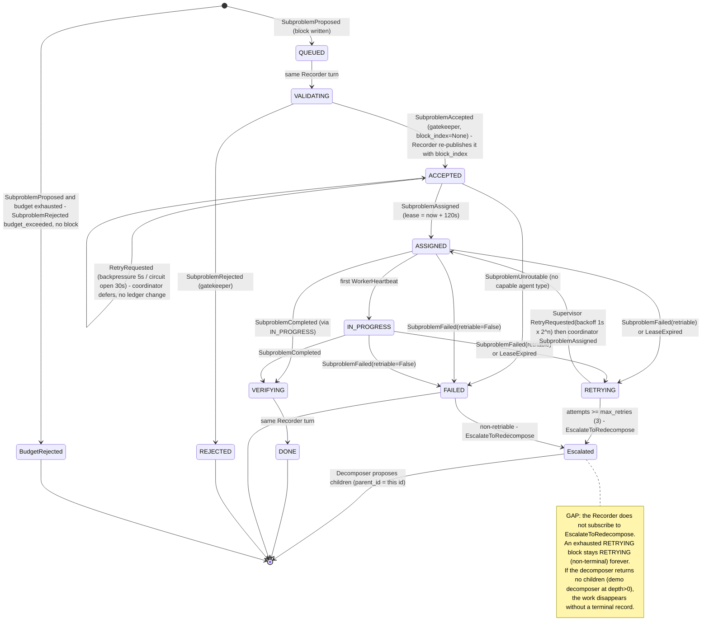
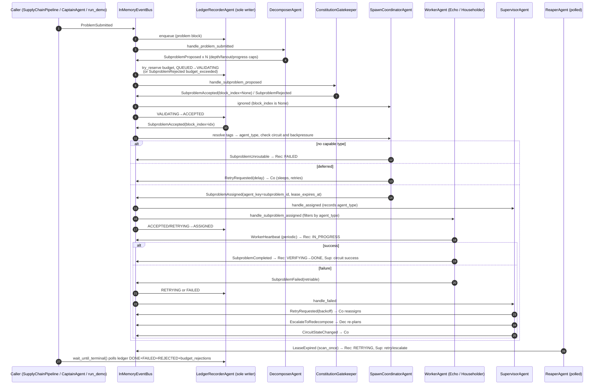

# 02 — Event-driven supply-chain runtime

Part of the [architecture overview](00-overview.md).

> Branch snapshot: `feat/nebius-claude-sandbox` (2026-10-12). Code was read, not
> executed. Where code and prose disagree, the code is authoritative and the
> disagreement is listed in [§5](#5-implemented-vs-planned).

## 1. Purpose and authority

This runtime is the in-process path that takes a free-text problem and turns it
into finished subproblems. A problem is decomposed into subproblems. Each one is
admitted by the constitution, routed by capability tag to a worker type,
executed, and supervised (retry, backoff, circuit breaking, escalation). Every
lifecycle step is recorded by the single ledger writer.

Authority boundaries:

- **Event contracts** (`agenten/events/schemas.py`) are the shared vocabulary.
  They import neither AutoGen nor orchestration code.
- **Business agents** (decomposer, gatekeeper, coordinator, workers,
  supervisor, reaper) only *publish* events. None of them writes the ledger.
- **`LedgerRecorderAgent`** is the sole writer and the only component that
  decides stage transitions, including FAILED vs RETRYING
  (`agenten/ledger_bridge/recorder.py`).
- **`build_pipeline()`** is the composition root. It owns which bus is used,
  every subscription, and boot-time validation of capability routing.
- This runtime is the **deterministic, offline fallback path** (`main.py demo`).
  It is *not* the production delivery authority. The MariaDB Ledger-Gateway
  owns that role ([WORKSTREAMS.md](../WORKSTREAMS.md#integration-rule)).

## 2. Components

| Module | Responsibility | Key types / functions (verified) |
| --- | --- | --- |
| [`agenten/events/schemas.py`](../../agenten/events/schemas.py) | Frozen Pydantic event contracts; topic naming `supplychain.<ClassName>` | `EventMeta`, `make_meta`, `topic_for`, `ProblemSubmitted`, `SubproblemProposed`, `SubproblemAccepted`, `SubproblemRejected`, `SubproblemAssigned`, `WorkerHeartbeat`, `SubproblemCompleted`, `SubproblemFailed`, `SubproblemUnroutable`, `LeaseExpired`, `RetryRequested`, `EscalateToRedecompose`, `CircuitStateChanged`, `RejectionReason`, `CircuitState` |
| [`agenten/events/__init__.py`](../../agenten/events/__init__.py) | Public re-export of the contract | Re-exports everything above **except** `SubproblemUnroutable` |
| [`agenten/runtime/event_bus.py`](../../agenten/runtime/event_bus.py) | Bus ports and the in-memory bus (at-least-once contract, idempotency by `event_id`) | `EventBus` (publish-only ABC), `SubscribableEventBus`, `InMemoryEventBus`, `Handler` |
| [`agenten/runtime/autogen_bus.py`](../../agenten/runtime/autogen_bus.py) | Publish-only adapter over `autogen_core`; topic source = `meta.root_problem_id`; one-shot relay for the live demo | `AutoGenEventBus`, `DEFAULT_TOPIC_SOURCE`, `AutoGenOneShotRuntimeRelay`, `LiveDemoRuntimeMessage`, `LIVE_DEMO_RUNTIME_TOPIC` |
| [`agenten/runtime/bootstrap.py`](../../agenten/runtime/bootstrap.py) | Builds a real AutoGen runtime and bus; `TypeSubscription` helper | `build_runtime_and_bus`, `subscribe_type`, `register_runtime_swarm` |
| [`agenten/runtime/autogen_one_shot.py`](../../agenten/runtime/autogen_one_shot.py) | Public facade for the one-shot relay | re-exports from `autogen_bus` |
| [`agenten/decomposition/decomposer.py`](../../agenten/decomposition/decomposer.py) | Problem or escalated subproblem → `SubproblemProposed`; local depth, fanout, and progress caps | `DecomposerAgent`, `LlmDecompose`, `DescribeSubproblem` |
| [`agenten/decomposition/budget.py`](../../agenten/decomposition/budget.py) | Budget model; total cap is reserved by the Recorder | `DecompositionBudget`, `BudgetLedger` |
| [`agenten/constitution/gatekeeper.py`](../../agenten/constitution/gatekeeper.py) | Two-layer admission: deterministic checks, then the injected LLM judge | `ConstitutionGatekeeper`, `LlmJudge`, `GatekeeperRoutedAgent` |
| [`agenten/spawning/capability_registry.py`](../../agenten/spawning/capability_registry.py) | Capability tag → agent type; first matching tag wins | `CapabilityRegistry`, `NoCapableAgentType` |
| [`agenten/spawning/coordinator.py`](../../agenten/spawning/coordinator.py) | Finalized accept → assignment; backpressure, circuit deferral, unroutable outcome, `event_id` dedup | `SpawnCoordinatorAgent`, `RoutedSpawnCoordinatorAgent`, `BACKPRESSURE_RETRY_DELAY_SECONDS`, `CIRCUIT_OPEN_RETRY_DELAY_SECONDS` |
| [`agenten/workers/base.py`](../../agenten/workers/base.py) | Worker seam: assignment in, heartbeat plus completed or failed out | `WorkerAgent`, `WorkerExecutionError`, `WorkerFactory`, `DescriptionResolver`, `make_routed_agent_class` |
| [`agenten/workers/echo_worker.py`](../../agenten/workers/echo_worker.py), [`research_worker.py`](../../agenten/workers/research_worker.py) | Concrete workers (`echo`/`test` and `research`/`web_search` tags) | `EchoWorker`, `ResearchWorker` |
| [`agenten/household/worker.py`](../../agenten/household/worker.py) | Role-parameterized worker injected through factories (demo fleet) | `HouseholderWorker`, `create_householder_worker_factories` |
| [`agenten/supervision/supervisor.py`](../../agenten/supervision/supervisor.py) | Retry with exponential backoff, escalation, per-type circuit breaker | `SupervisorAgent`, `SupervisorRoutedAgent`, `CIRCUIT_ROOT_ID`; policy in [`config/app_settings.py`](../../config/app_settings.py) `RETRY_POLICY` |
| [`agenten/supervision/reaper.py`](../../agenten/supervision/reaper.py) | Poll-based lease watchdog over the ledger read side | `ReaperAgent.scan_once`, `ReaperAgent.run_forever` |
| [`agenten/ledger_bridge/recorder.py`](../../agenten/ledger_bridge/recorder.py) | Sole writer: inbox plus a single writer task; budget reservation; stage transitions | `LedgerRecorderAgent`, `RECORDER_SUBSCRIPTION_SPEC`, `RECORDER_TOPICS`, `subscribe_recorder`, `LedgerRecorderRoutedAgent` |
| [`agenten/ledger_bridge/stage_machine.py`](../../agenten/ledger_bridge/stage_machine.py) | Stage enum and legal transitions | `Stage`, `TERMINAL_STAGES`, `ALLOWED_TRANSITIONS`, `validate_transition`, `LedgerQuery` |
| [`agenten/orchestration/pipeline.py`](../../agenten/orchestration/pipeline.py) | Composition root on `InMemoryEventBus`; boot validation; submit and wait helpers | `build_pipeline`, `SupplyChainPipeline` (`start`, `stop`, `submit_problem`, `wait_until_terminal`), `PipelineBootError` |
| [`agenten/demo.py`](../../agenten/demo.py) | Offline demo: 4 atomic subproblems → 4 householders, JSON evidence | `run_demo`, `DemoSummary`, `_deterministic_decompose` |
| [`main.py`](../../main.py) | CLI: `demo`, `legacy`, `recover-gateway`, `live-demo-a2` | `main`, `parse_args`, `demo_output_path` |

## 3. Subproblem lifecycle

The ledger `Stage` values (`stage_machine.py:16-42`) are the states. The arrow
labels name the event that the Recorder applies.

Notes on the diagram:

- **Dead-letter.** Permanently unroutable work now has a durable terminal
  outcome (`SubproblemUnroutable` → `FAILED` with `unroutable_capability_tags`,
  `recorder.py:902-918`). The remaining gap is the escalation path described
  in the note above.
- **Late events.** A stale failure, unroutable, or lease event that arrives
  after a terminal stage is kept as a forensic `late_event` and does not change
  the stage (`recorder.py:509`).
- **Leases.** A heartbeat moves ASSIGNED → IN_PROGRESS but does **not** extend
  the lease (`recorder.py:775-783`). A worker that runs longer than
  `lease_duration_seconds` (120s) is reaped even if it is healthy.

## 4. Event dataflow (happy path plus retry)

All topics are `topic_for(Cls)` = `supplychain.<Cls>`. Subscriptions are wired
in `pipeline.py:319-475` on `InMemoryEventBus`, which delivers in order and
nests every handler inside the publisher's `await`.

## 5. Implemented vs planned

| Capability | Status | Evidence |
| --- | --- | --- |
| Frozen Pydantic events with `EventMeta` idempotency fields | Implemented | `agenten/events/schemas.py:36-190` |
| Publish/subscribe split (`EventBus` vs `SubscribableEventBus`) | Implemented, matches spec | `event_bus.py:17-33`; [segregation spec §Decision](../superpowers/specs/2026-07-16-event-bus-capability-segregation-design.md) |
| `build_pipeline` rejects a publish-only bus | Implemented | `pipeline.py:302-304` |
| Recorder no longer subscribes itself (`subscribe_recorder`) | Implemented | `recorder.py:935`, `pipeline.py:319-320` |
| AutoGen publish adapter, topic source = `root_problem_id` | Implemented | `autogen_bus.py:50-70` |
| Full pipeline on real AutoGen runtime (RoutedAgents + `TypeSubscription`s) | **Planned / not wired.** Only a single worker round trip is proven | `pipeline.py:16-32`; `tests/test_pipeline_autogen_subscription.py`. No RoutedAgent exists for `DecomposerAgent` or `ReaperAgent` |
| Boot validation of capability → subscribed worker type | Implemented (InMemory wiring only) | `pipeline.py:384-397`, `508-547` |
| Worker factory injection, one owner per tag | Implemented | `pipeline.py:384-408`; [householder contract spec](../superpowers/specs/2026-07-15-householder-runtime-contract-design.md) |
| Four deterministic householders in the demo | Implemented | `demo.py:52-76`, `134-139`; [householder runtime spec](../superpowers/specs/2026-07-15-householder-runtime-design.md) |
| Durable outcome for unroutable work | Implemented | `coordinator.py:186-208`, `recorder.py:902-918`; [gap todos L39](../superpowers/plans/2026-07-15-architecture-gap-todos.md) |
| Terminal record for escalated (exhausted) subproblems | **Missing** | Recorder spec list has no `EscalateToRedecompose` (`recorder.py:118-129`); supervisor escalation at `supervisor.py:154-172` |
| Retry/backoff/escalation and circuit breaker | Implemented (in-memory, single process) | `supervisor.py:137-182`, `271-335`; `config/app_settings.py:6-10` |
| Lease reaping | Implemented, but poll-only and not started by `build_pipeline` | `reaper.py:60-110`; `pipeline.py:440-451` |
| Lease renewal on heartbeat | **Not implemented** (deliberate) | `recorder.py:775-783` |
| Crash recovery / replay | Implemented as a function in the ledger bridge; **no production call site** (`build_pipeline` does not call it, only tests do) | `agenten/ledger_bridge/recovery.py:64`; see [03 §5](03-ledger-gateway.md#5-implemented-vs-planned) |
| Per-root budget on re-decomposition | **Partial.** Escalation uses the default budget, not the root's | `decomposer.py:87-93` |
| Bus-level quiescence / orderly shutdown | Not implemented; ledger polling instead | `pipeline.py:216-252`; `recorder.py:234-280` |
| Exactly-once terminal recording proven end-to-end | Planned | [gap todos L43](../superpowers/plans/2026-07-15-architecture-gap-todos.md) |
| Split `pipeline.py` / `recorder.py` | Planned | gap todos L47-48 |

**Disagreements (code wins):**

1. **`AGENTS.md`** ("Known active concerns") says unroutable work lacks a
   durable dead-letter event. That is stale: `SubproblemUnroutable` → `FAILED`
   is implemented, and the gap-todo L39 is checked. The real remaining gap is
   the escalation and RETRYING limbo described in §3.
2. **Gap todo L38** asks to replace "`AutoGenEventBus.subscribe`
   `NotImplementedError`". That method no longer exists; the segregation spec
   removed it (`autogen_bus.py:50-70`). The checkbox is stale.
3. **`agenten/events/__init__.py:5`** cites `docs/ARCHITECTURE_V2.md`, which
   does not exist. The same file also omits `SubproblemUnroutable` from its
   re-exports and `__all__`, even though it calls itself "the frozen contract".
4. **The `autogen_bus.py:3-4` docstring** says it is "the ONLY file … allowed
   to import autogen_core". In fact `bootstrap.py`, the soft-import adapters in
   `coordinator.py`, `gatekeeper.py`, `recorder.py`, `supervisor.py`, and
   `workers/base.py`, plus a **hard** import in `agenten/demo.py:9`
   (`autogen_core.models`) all import it. The "offline" demo therefore still
   needs `autogen-core` installed.
5. **`autogen_bus.py:37`** imports `agenten.agent_runtime.contracts`. This
   couples the runtime port package to the agent-runtime control plane, which
   conflicts with AGENTS.md's "runtime = event-bus ports and adapter" boundary.
6. **`tests/test_pipeline_autogen_subscription.py`** (docstring) still
   describes `LedgerRecorderAgent` as self-subscribing. That changed with
   `subscribe_recorder`.
7. **[`docs/ARCHITECTURE.md`](../ARCHITECTURE.md)** does not describe this
   event path at all (gap todo L28 is still open). **AGENTS.md** calls the
   ledger "append-only", while `ARCHITECTURE.md §Ledger integrity boundary`
   correctly states that the in-process Recorder mutates blocks in place.
8. **The [hackathon spec §1/§3/§6](../superpowers/specs/2026-07-15-hackathon-pipeline-design.md)**
   describes the Captain as an HTTP client of a FastAPI Ledger-Gateway, with a
   driver at `agenten/pipeline/captain_pipeline.py`. The code lives at
   `agenten/planning/captain_pipeline.py` and imports nothing from this event
   runtime. The two pipelines are parallel systems, not one flow.
9. **Coordinator retry semantics.** `RetryRequested` is reused for
   backpressure and circuit deferrals (`coordinator.py:249-254`), and
   `handle_retry_requested` sleeps inline (`coordinator.py:126`). On
   `InMemoryEventBus` this blocks the publishing chain for the whole backoff,
   so "async retry" is in practice a nested wait.

## 6. Interfaces to other parts

| Part | Interface | Direction / notes |
| --- | --- | --- |
| **Captain planning** ([01](01-captain-planning.md)) | `CaptainAgent.build_default_supply_chain_pipeline` / `submit_problem_to_supply_chain` (`agenten/Captain.py:227-294`). `agenten/planning/captain_pipeline.py` is independent. | The legacy pyautogen Captain is a thin client of `build_pipeline`, with its own separate `Blockchain`. The canonical Captain planning/release path does not use this bus. |
| **Ledger / gateway** ([03](03-ledger-gateway.md)) | `LedgerRecorderAgent`, `LedgerQueryImpl`, `InProcessBudgetLedger`, `recover_on_startup`, `Stage` | Business agents read through `LedgerQuery` and never write. The MariaDB gateway is the production authority. Keeping the gateway behind the same writer/query port is an open item (gap todo L42). |
| **Delivery / Minibook** ([04](04-delivery-minibook.md)) | `agenten/delivery/events.py` `DeliveryEventPublisher` → `EventBus.publish("delivery.events", …)` | Only the `EventBus` port is shared. The topic sits outside the `supplychain.*` namespace, and the publisher calls `asyncio.run` from synchronous code. Minibook has no direct coupling (the projection is owned by [04](04-delivery-minibook.md)). |
| **Agent factory / Hermes** ([05](05-agent-factory.md)) | `agenten/agent_factory/live_demo_runtime_chain.py` uses `AutoGenOneShotRuntimeRelay` (`autogen_bus.py:111`); `register_runtime_swarm` (`bootstrap.py:48`); `main.py live-demo-a2` | This is the only production use of the real AutoGen runtime: one message delivered through `TypeSubscription`. It does not go through the supply-chain events. |
| **Coding execution** ([06](06-coding-execution.md)) (`agenten/coding_agent`, `agenten/execution`) | None directly | Reached through the agent-runtime control plane, not through `WorkerAgent`. A coding worker would plug in through a `WorkerFactory` with its own capability tag. |
| **Workers / householders** | `WorkerFactory(bus, tools, heartbeat_interval_seconds, description_resolver)`; `HouseholderExecutor` port | The factory returns one unsubscribed worker, and the pipeline subscribes and validates it. |
| **LLM** | `LlmDecompose`, `LlmJudge` callables; `agenten.llm.make_llm_decompose` / `make_llm_judge` | Both are injected and required (`pipeline.py:255-301`). The demo injects deterministic stand-ins. |
| **Ops** ([07](07-operations-live-demo.md)) | `config/app_settings.py RETRY_POLICY`; constitution YAML through `load_constitution(path)`; `main.py demo --output` | This runtime starts no services, needs no Docker, and needs no secrets on the deterministic path. |

## 7. Sources

- Code: [`agenten/events/`](../../agenten/events/), [`agenten/runtime/`](../../agenten/runtime/),
  [`agenten/decomposition/`](../../agenten/decomposition/), [`agenten/constitution/gatekeeper.py`](../../agenten/constitution/gatekeeper.py),
  [`agenten/spawning/`](../../agenten/spawning/), [`agenten/workers/`](../../agenten/workers/),
  [`agenten/household/worker.py`](../../agenten/household/worker.py), [`agenten/supervision/`](../../agenten/supervision/),
  [`agenten/ledger_bridge/recorder.py`](../../agenten/ledger_bridge/recorder.py), [`agenten/ledger_bridge/stage_machine.py`](../../agenten/ledger_bridge/stage_machine.py),
  [`agenten/orchestration/pipeline.py`](../../agenten/orchestration/pipeline.py), [`agenten/demo.py`](../../agenten/demo.py),
  [`main.py`](../../main.py), [`agenten/Captain.py`](../../agenten/Captain.py), [`agenten/delivery/events.py`](../../agenten/delivery/events.py),
  [`agenten/agent_factory/live_demo_runtime_chain.py`](../../agenten/agent_factory/live_demo_runtime_chain.py), [`config/app_settings.py`](../../config/app_settings.py)
- Tests (referenced, not run): `tests/test_e2e_smoke.py`, `tests/test_pipeline_autogen_subscription.py`,
  `tests/test_autogen_bus_integration.py`, `tests/spawning/test_coordinator.py`, `tests/ledger_bridge/test_recorder.py`,
  `tests/test_supervisor.py`, `tests/test_reaper.py`, `tests/test_worker_factories.py`
- Specs: [hackathon pipeline design](../superpowers/specs/2026-07-15-hackathon-pipeline-design.md),
  [event-bus capability segregation](../superpowers/specs/2026-07-16-event-bus-capability-segregation-design.md),
  [householder runtime contract](../superpowers/specs/2026-07-15-householder-runtime-contract-design.md),
  [householder runtime](../superpowers/specs/2026-07-15-householder-runtime-design.md)
- Plans and docs: [architecture gap todos](../superpowers/plans/2026-07-15-architecture-gap-todos.md),
  [unroutable-work plan](../superpowers/plans/2026-07-15-unroutable-work-architecture-gate.md),
  [ARCHITECTURE.md](../ARCHITECTURE.md), [WORKSTREAMS.md](../WORKSTREAMS.md), `AGENTS.md` (repo root)
