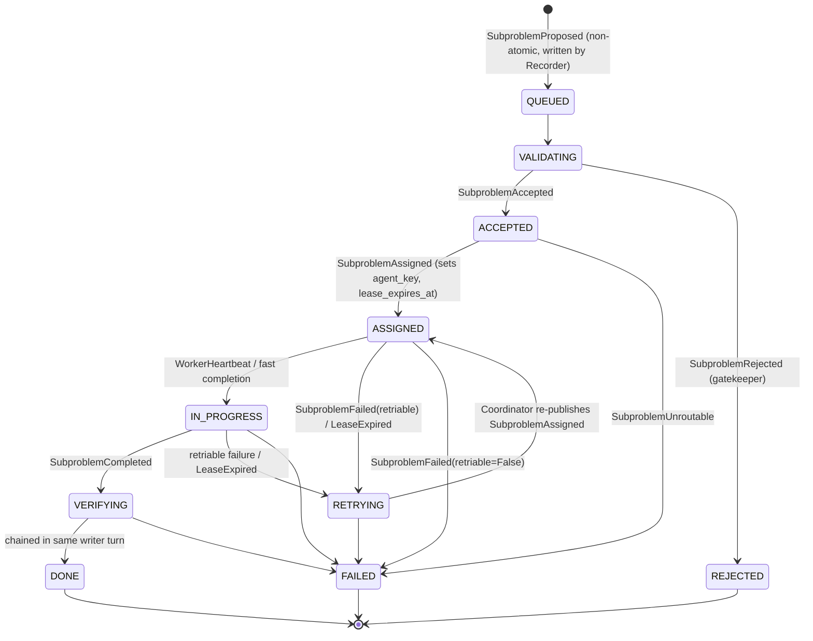
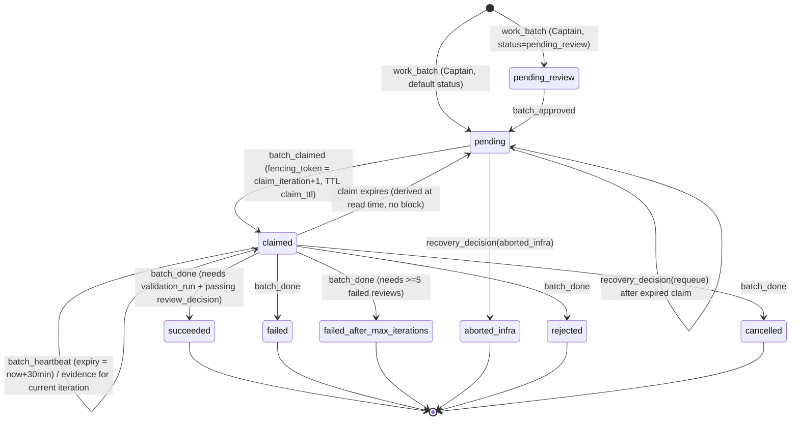
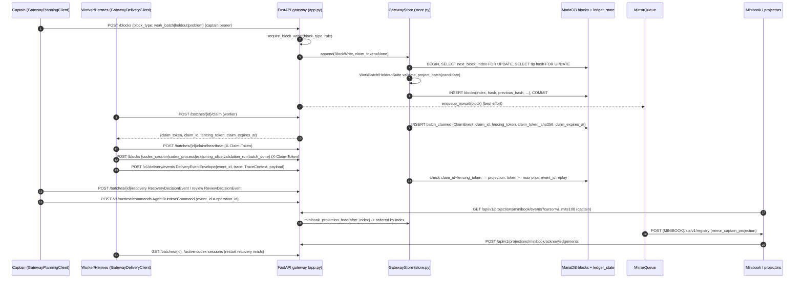

# 03 — Ledger, blockchain & gateway

Part of the [architecture overview](00-overview.md).

> Scope: the append-only hash-chained ledger (`blockchain/`), the in-process
> sole writer (`agenten/ledger_bridge/`), and the FastAPI Ledger Gateway with its
> MariaDB `blocks` table (`gateway/`). Verified against branch
> `feat/nebius-claude-sandbox`. Where code and prose disagree, the code is
> treated as authoritative, and the disagreement is flagged in §5.

## 1. Purpose and authority

Captain Cook has **two ledgers that share one `Block` type**, and each has a
different authority model:

| Ledger | Writer | Storage | Integrity guarantee |
|---|---|---|---|
| **Gateway ledger** (production delivery authority) | `GatewayStore` in `gateway/store.py`, behind role-scoped HTTP routes | MariaDB `blocks` table via `MariaDBStorage` | Strict append-only. No `UPDATE` or `DELETE` is ever issued against `blocks`. Each row is hash-chained to the current tip under a row lock, and lifecycle state is *derived* from child events, never stored. |
| **In-process pipeline ledger** (event-driven supply chain) | `LedgerRecorderAgent` (single asyncio writer loop) | `Blockchain` over `JSONFileStorage` / `InMemoryStorage` (any `LedgerStorage`) | Single-writer discipline plus validated stage transitions. Blocks are mutated in place (`status`, `data`, `metadata`, `children`) and hashes are **not** recomputed, so the chain is *not* hash-verifiable. |

Invariants (enforced in code):

1. **Sole writer.** In the pipeline, only `LedgerRecorderAgent._writer_loop` calls
   `Blockchain.add_block` / `update_task_status`. Other units publish events
   ([recorder.py:1-35](../../agenten/ledger_bridge/recorder.py)). In the gateway,
   every block insert goes through `GatewayStore._next_index` → `_new_block` →
   `_insert` inside one MariaDB transaction ([store.py:6155-6205](../../gateway/store.py)).
2. **Hash chain.** `Block.compute_hash` is SHA-256 over canonical JSON of
   `{index, block_type, data, previous_hash, parent_index}`
   ([Blockchain_modell.py:42](../../blockchain/Blockchain_modell.py)). `status`,
   `children` and `metadata` are *outside* the hash in both ledgers.
3. **Monotonic index.** In the gateway, `ledger_state.next_block_index` is
   read `FOR UPDATE` and incremented, and the tip hash is read
   `ORDER BY index DESC LIMIT 1 FOR UPDATE` ([store.py:6155](../../gateway/store.py),
   [store.py:6183](../../gateway/store.py)).
4. **Idempotent replay.** Identical canonical content returns the original
   block or event. The same identity with different content returns `409`
   (`_IdempotentReplay`, `_DeliveryEventReplay`, `_RuntimeReplay`).
5. **Fencing.** Worker writes need a live claim token (hash compare + expiry).
   Delivery events must carry a fencing token ≥ every prior token for the same
   `(project_id, run_id, batch_id)` ([store.py:2081](../../gateway/store.py)).
6. **Projections never write truth.** The Minibook mirror and feed are
   best-effort and read-only toward `blocks` ([mirror.py](../../gateway/mirror.py)).

## 2. Components

| Path | Responsibility | Key types / functions (verified) |
|---|---|---|
| [blockchain/Blockchain_modell.py](../../blockchain/Blockchain_modell.py) | Generic block model, hash chain, verification | `Block`, `Block.compute_hash`, `Blockchain.add_block`, `Blockchain.update_task_status`, `Blockchain.get_blocks_by_type`, `verify_chain`, `ChainVerificationError` |
| [blockchain/storage.py](../../blockchain/storage.py) | Storage port and file/memory backends | `LedgerStorage` (`load`/`save`/`clear`), `JSONFileStorage` (atomic `os.replace`), `InMemoryStorage` |
| [blockchain/mariadb_storage.py](../../blockchain/mariadb_storage.py) | MariaDB backend and `blocks` DDL | `MariaDBStorage`, `transaction()`, `_ensure_schema`, `append_block`, `load_by_status`, `_decode_row`; `save`/`clear` issue `DELETE FROM blocks` (compatibility only) |
| [agenten/ledger_bridge/stage_machine.py](../../agenten/ledger_bridge/stage_machine.py) | Pipeline stage enum, transition table, read port | `Stage`, `TERMINAL_STAGES`, `ALLOWED_TRANSITIONS`, `validate_transition`, `LedgerQuery` |
| [agenten/ledger_bridge/recorder.py](../../agenten/ledger_bridge/recorder.py) | Sole pipeline writer (U8) | `LedgerRecorderAgent` (`handle_*` enqueue, `_apply_*` apply), `_writer_loop`, `_transition`, `_record_late_event`, `_apply_retry_transition`, `RECORDER_SUBSCRIPTION_SPEC`, `RECORDER_TOPICS`, `subscribe_recorder`, `LedgerRecorderRoutedAgent` |
| [agenten/ledger_bridge/query.py](../../agenten/ledger_bridge/query.py) | CQRS read side and crash-safe budget | `LedgerQueryImpl`, `build_status_index`, `InProcessBudgetLedger` |
| [agenten/ledger_bridge/recovery.py](../../agenten/ledger_bridge/recovery.py) | Startup recovery that rebuilds state from the ledger, not the bus (U9) | `recover_on_startup` → summary dict (`queued_or_validating`, `accepted`, `lease_expired`, `*_flagged`) |
| [gateway/store.py](../../gateway/store.py) | All gateway SQL: append, claim/heartbeat, recovery, review, delivery events, runtime ops, factory leases, projections | `GatewayStore`, `append`, `claim`, `heartbeat`, `approve`, `recover`, `review`, `append_delivery_event`, `accept_runtime_command`, `runtime_operation`, `record_factory_lease`, `minibook_projection_feed`, `_retry_write` |
| [gateway/contracts.py](../../gateway/contracts.py) | Payload schemas and pure projections | `TraceContext`, `DeliveryEventEnvelope`, `ClaimEvent`, `HeartbeatEvent`, `RecoveryDecisionEvent`, `ReviewDecisionEvent`, `BatchDoneEvent`, `BatchProjection`, `project_batch`, `ReleaseProjection`, `project_release`, `RuntimeOperationProjection` |
| [gateway/app.py](../../gateway/app.py) | FastAPI app `Captain Cook Ledger Gateway`; routes and role guards | `create_app`, `require_block_writer`, `require_factory_block_writer`, `require_skill_event_writer`, `CAPTAIN_WRITE_BLOCK_TYPES`, `main` |
| [gateway/auth.py](../../gateway/auth.py) / [gateway/settings.py](../../gateway/settings.py) | Bearer roles and settings | `GatewayRole` {`captain`, `worker`, `provider_receipt`}, `require_captain/worker/reader`; `GatewaySettings` (`host` fixed to `127.0.0.1`, `port` 8090, `claim_ttl_seconds` 5400) |
| [gateway/mirror.py](../../gateway/mirror.py), [gateway/registry_feed.py](../../gateway/registry_feed.py) | Non-blocking Minibook mirroring | `MirrorQueue`, `mirror_captain_projection`, `mirror_validated_batch`, `runtime_result_projection` |
| [gateway/capability_resume_repository.py](../../gateway/capability_resume_repository.py) | Second module that appends blocks, using `GatewayStore` private helpers | `GatewayCapabilityResumeRepository` |
| [agenten/agent_factory/leases.py](../../agenten/agent_factory/leases.py) | Factory-role lease issue and validation | `FACTORY_LEASE_DURATION` (15 min), `issue_factory_lease`, `validate_factory_lease`, `FactoryLeaseDenied` |
| [agenten/delivery/gateway_client.py](../../agenten/delivery/gateway_client.py), [agenten/planning/gateway_client.py](../../agenten/planning/gateway_client.py) | HTTP writers (worker / Captain planning) | `GatewayDeliveryClient`, `GatewayPlanningClient` |
| [docker-compose.yml](../../docker-compose.yml) | Captain-owned MariaDB 11.8.8 (`ledger_data` volume, `127.0.0.1:3306`) and Mailpit | The gateway itself is **not** containerized. It runs as `python -m gateway.app` ([scripts/live-demo-services.ps1:418](../../scripts/live-demo-services.ps1)). |

MariaDB tables. All are created idempotently with `CREATE TABLE IF NOT EXISTS`,
and there is no migration framework.

- `blocks`: PK `index`, FK `parent_index → blocks(index)`, JSON `data/children/metadata`, `hash`, `previous_hash`, `created_at`.
- `ledger_state`: single-row index allocator.
- Secondary projection tables keyed by `block_index`: `validated_capabilities`, `factory_*`, `capability_resume_authorizations`, `portal_*`, `minibook_projection_rebuild_receipts`. Also `capability_assembly_*` and `portal_setup_*` in their own repositories.

## 3. Lifecycle

### 3a. Pipeline subproblem block (in-process ledger, `stage_machine.py`)

A proposal that exceeds the root budget gets no block at all: the Recorder
publishes `SubproblemRejected(budget_exceeded)` instead (see
[02 §3](02-event-runtime.md#3-subproblem-lifecycle)).
Late or illegal events never overwrite outcome fields. They are appended to
`metadata.late_events` (or `retry_history`) and recorded in `recorder.errors`.

### 3b. Gateway work batch, claim lease, and fencing (`project_batch`)

An expired claim cannot be re-claimed until Captain records a
`recovery_decision`, and only when there is no active Codex session for that
iteration ([store.py:6632](../../gateway/store.py), [store.py:6389](../../gateway/store.py)).
Status is never stored. `project_batch` replays the children of the
`work_batch` on every read and rejects any event after a terminal `batch_done`
([contracts.py:1077](../../gateway/contracts.py)).

## 4. Dataflow

Payload schemas on the wire:

- **Batch lifecycle:** `WorkBatch`, `HoldoutSuite`, `ClaimEvent`, `HeartbeatEvent`, `CodexProcessEvent`, `ReasoningSliceEvent`, `RecoveryDecisionEvent`, `ReviewDecisionEvent`, `BatchDoneEvent`.
- **Delivery events:** `DeliveryEventEnvelope`. The `trace` field is a `TraceContext`, and the payload is a union discriminated by `event_type`.
- **Runtime:** `AgentRuntimeCommand`, `CapabilityGrant`, `AgentRuntimeResult`, read back through `RuntimeOperationProjection`.
- **Factory:** `FactoryLease`, `FactoryEvidenceBlock`.

Delivery events are stored as `block_type='delivery_event'` with
`metadata.schema = captain-delivery-event/v1`.

**`trace_id` / `operation_id`:**

- `TraceContext` ([contracts.py:276](../../gateway/contracts.py)) requires `project_id`, `run_id` and `trace_id`. `DeliveryEventEnvelope` adds required fields per event type; for example, the `codex_session_*` events need `batch_id`, `worker_id`, `claim_id`, `fencing_token` and `session_id`.
- `operation_id` is the `event_id` of an `agent_runtime_command`. Grants, revocations and results link back through `command_id`, and `runtime_operation()` reassembles them ([store.py:2611](../../gateway/store.py)).
- Runtime commands are also fenced by a monotonic `subject_version` per `subject_id` ([store.py:2166](../../gateway/store.py)).

The pipeline ledger has no HTTP path. Events reach `LedgerRecorderAgent` over
`EventBus`, and `recover_on_startup` re-publishes `SubproblemProposed`,
`SubproblemAccepted` and `LeaseExpired` from `LedgerQuery.blocks_in_stage`.

## 5. Implemented vs planned

| Capability | Status | Evidence |
|---|---|---|
| Hash-chained `Block`, pluggable storage | Implemented | [Blockchain_modell.py:19](../../blockchain/Blockchain_modell.py), [storage.py:13](../../blockchain/storage.py) |
| `verify_chain` for the append-only gateway ledger | Implemented, **test-only** (no production caller) | [Blockchain_modell.py:71](../../blockchain/Blockchain_modell.py); used only in `tests/blockchain/test_chain_verification.py` |
| MariaDB `blocks` + transactional append, deadlock retry (1020/1213, 3 attempts) | Implemented | [mariadb_storage.py:59](../../blockchain/mariadb_storage.py), [store.py:187](../../gateway/store.py), [store.py:6240](../../gateway/store.py) |
| Sole-writer recorder, validated transitions, at-least-once dedup (`_seen_event_ids`, in-memory only) | Implemented | [recorder.py:327-347](../../agenten/ledger_bridge/recorder.py) |
| Startup recovery from the ledger | Implemented as a function; **no production call site** (only `tests/ledger_bridge/test_recovery.py`) | [recovery.py:64](../../agenten/ledger_bridge/recovery.py) |
| `recovery_attempts` counter | **Read but never written.** The Recorder never stamps it, so `attempt` is always 0. | [recovery.py:50](../../agenten/ledger_bridge/recovery.py) |
| Claim lease + claim-token fence on `/blocks` | Implemented | [store.py:6207](../../gateway/store.py), [store.py:6632](../../gateway/store.py) |
| Numeric fencing-token rejection | Implemented for `/v1/delivery/events` only. `/blocks` evidence is fenced by token hash + expiry + iteration, not by `fencing_token`. | [store.py:2040-2081](../../gateway/store.py) |
| Heartbeat lease extension | Implemented, but hard-coded to 30 min, so a heartbeat can **shorten** the default 90 min `claim_ttl` | [store.py:6694](../../gateway/store.py), [settings.py:49](../../gateway/settings.py) |
| Dead-letter for unroutable work | Implemented: the coordinator emits `SubproblemUnroutable`, and the Recorder persists it as terminal `FAILED` with `unroutable_capability_tags`. The AGENTS.md concern is stale (gap todo L39 is checked). The remaining gap is escalated work, see [02 §5](02-event-runtime.md#5-implemented-vs-planned) | [recorder.py:902](../../agenten/ledger_bridge/recorder.py) |
| Generic `GET /events?after_index` + `PUT /consumers/{name}/cursor` + `gateway_consumer_cursors` | **Planned, not implemented.** The code exposes a Minibook-specific feed (`/api/v1/projections/minibook/events?cursor=`) and keeps the cursor in a consumer-side SQLite `ProjectionCursorStore`. | spec [07-16 §Architecture](../superpowers/specs/2026-07-16-gateway-native-delivery-runtime-design.md); [app.py:1021](../../gateway/app.py), [agenten/delivery/projection_cursor.py](../../agenten/delivery/projection_cursor.py) |
| Gateway event set §6 (`codex_task`, `artifact_built`, `deploy`, `e2e_run`, `evaluation`, `release_decision`, `registry_mirror`) | Implemented as `DeliveryEventEnvelope` payload types | [contracts.py:687](../../gateway/contracts.py); spec [07-17 §6](../superpowers/specs/2026-07-17-gateway-native-delivery-runtime-design.md) |
| Release gate: 3 clean E2E runs | Implemented | [contracts.py:809](../../gateway/contracts.py) |
| Mandatory disposable-MariaDB CI gate | Tests exist behind `TEST_MARIADB_DSN`; the single-command gate is a plan item | spec [gap-remediation §5](../superpowers/specs/2026-07-16-system-gap-remediation-design.md) |
| Schema migrations | None. DDL is applied by `CREATE TABLE IF NOT EXISTS` at boot. | [store.py:323](../../gateway/store.py) |

**Contradictions (code wins):**

1. **Event names.** Spec 07-17 §6 calls them `batch_claim` / `claim_heartbeat`.
   The code uses `batch_claimed` / `batch_heartbeat` ([store.py:184](../../gateway/store.py)).
2. **`batch_done` outcomes.** Spec 07-17 §6 lists `succeeded|failed|blocked|escalated`.
   Code `TerminalOutcome` is `succeeded|failed|rejected|cancelled|failed_after_max_iterations|aborted_infra` ([contracts.py:844](../../gateway/contracts.py)).
   The delivery-event payload `DeliveryBatchDonePayload` still uses the spec vocabulary, so two
   `batch_done` schemas share one name (see [04 §5](04-delivery-minibook.md#5-implemented-vs-planned-code-wins)).
3. **Repair budget.** Spec 07-17 §2.7 allows ≤3 repair resumes. Spec 07-16 and the code
   require 5 failed reviews for `failed_after_max_iterations` ([contracts.py:1214](../../gateway/contracts.py)).
4. **Idempotency key.** Spec 07-17 §6 names a `command_id`. The code keys replay on
   `event_id` (delivery events, runtime commands); `command_id` is only the
   back-reference from grant and result.
5. **Stale fencing.** The spec says the gateway rejects stale fencing tokens generally.
   The code checks the numeric token only on `/v1/delivery/events` (see table).
6. **[ARCHITECTURE.md:353](../ARCHITECTURE.md)** says "to back the ledger with a database,
   implement `LedgerStorage`". That is stale, because `MariaDBStorage` exists. Also, its
   `save`/`clear` run `DELETE FROM blocks` with `ON DELETE CASCADE` FKs, so wrapping it in
   `Blockchain(storage=MariaDBStorage(...))` would break gateway append-only guarantees.
   No such call site exists today.
7. **"GatewayStore is the sole writer"** ([ARCHITECTURE.md:423](../ARCHITECTURE.md)).
   `GatewayCapabilityResumeRepository` also appends blocks. It calls the store's private
   `_next_index`/`_new_block`/`_insert` ([capability_resume_repository.py:100](../../gateway/capability_resume_repository.py)),
   so the chain discipline holds, but the writer boundary is the store's helpers, not the class.
8. **Local delivery stack spec** calls MariaDB the "future" ledger DB. It is now the
   production gateway store. The spec also implies Compose-managed services, but the
   gateway runs as a host process.
9. **Gateway `children` column** is always `[]`. Parents are never updated, and
   `parent_index` is the only link. The recorder docstring's `children` race
   applies only to the in-process ledger.
10. **Block type vs parent not cross-checked (hardening, not verified as an
    exploit).** Generic `POST /blocks` lets a worker with a live claim store an
    `agent_factory_block` under a `work_batch` parent. Promotion queries ignore
    it because they join on an `agent_factory_job` parent
    (`gateway/store.py:5263-5265,5510-5517`), but nothing rejects the write.

## 6. Interfaces to other parts

- **Event runtime ([02](02-event-runtime.md)):** the Recorder consumes the 10 event types in
  `RECORDER_SUBSCRIPTION_SPEC` from `agenten.events.schemas` over
  `EventBus`/`SubscribableEventBus`. It republishes `SubproblemAccepted`
  (with `block_index`) and `SubproblemRejected` (budget exhausted). The Reaper
  (`agenten/supervision/reaper.py`) emits `LeaseExpired` from
  `metadata.lease_expires_at`.
- **Decomposition ([01](01-captain-planning.md), [02](02-event-runtime.md)):** `BudgetLedger` / `DecompositionBudget`. `InProcessBudgetLedger`
  persists `budget_consumed` on the root `problem` block.
- **Orchestration ([02](02-event-runtime.md)):** `agenten/orchestration/pipeline.py::build_pipeline` constructs
  `Blockchain`, `InProcessBudgetLedger` and `LedgerRecorderAgent`, then calls
  `subscribe_recorder`.
- **Delivery workers / Hermes / Codex ([04](04-delivery-minibook.md), [06](06-coding-execution.md)):** `GatewayDeliveryClient` (claim, heartbeat,
  evidence, `/v1/delivery/events`, recovery/review, active Codex sessions).
- **Captain planning ([01](01-captain-planning.md)):** `GatewayPlanningClient.release(WorkBatch, HoldoutSuite)`
  and `GET /capabilities` (FULLTEXT over `validated_capabilities`).
- **Agent factory ([05](05-agent-factory.md)):** `/v1/factory/*` (jobs, leases, blocks, budget, skills,
  evaluations, release decisions) under `require_factory_block_writer`.
- **Agent runtime / provider proxy ([05](05-agent-factory.md), [06](06-coding-execution.md)):** `/v1/runtime/{commands,grants,grant-revocations,results,operations}`
  and provider settlements (`provider_receipt` role).
- **Minibook (read model, [04](04-delivery-minibook.md)):** the push path is `MirrorQueue` → `POST /api/v1/registry`.
  The pull path is `GatewayProjectionFeedClient` plus acknowledgements and rebuild receipts.
  Neither can mutate `blocks`.
- **Portal / n8n ([05](05-agent-factory.md), [07](07-operations-live-demo.md)):** the `/v1/portal/*` and `/v1/control/*` routes with their own
  tables. Captain-owned infra is MariaDB + Mailpit only. n8n is VibeMind-owned.

## 7. Sources

- Code: [blockchain/](../../blockchain/), [agenten/ledger_bridge/](../../agenten/ledger_bridge/),
  [gateway/store.py](../../gateway/store.py), [gateway/contracts.py](../../gateway/contracts.py),
  [gateway/app.py](../../gateway/app.py), [gateway/auth.py](../../gateway/auth.py),
  [gateway/settings.py](../../gateway/settings.py), [gateway/mirror.py](../../gateway/mirror.py),
  [gateway/registry_feed.py](../../gateway/registry_feed.py),
  [gateway/capability_resume_repository.py](../../gateway/capability_resume_repository.py),
  [agenten/agent_factory/leases.py](../../agenten/agent_factory/leases.py),
  [agenten/delivery/gateway_client.py](../../agenten/delivery/gateway_client.py),
  [docker-compose.yml](../../docker-compose.yml)
- Specs: [2026-07-15 local delivery stack](../superpowers/specs/2026-07-15-local-delivery-stack-design.md),
  [2026-07-16 gateway-native runtime](../superpowers/specs/2026-07-16-gateway-native-delivery-runtime-design.md),
  [2026-07-17 gateway-native Hermes runtime](../superpowers/specs/2026-07-17-gateway-native-delivery-runtime-design.md),
  [2026-07-16 system gap remediation](../superpowers/specs/2026-07-16-system-gap-remediation-design.md)
- Prose: [docs/ARCHITECTURE.md](../ARCHITECTURE.md) ("Ledger integrity boundary",
  "Minibook collaboration projection", "Blockchain: adding a new record type")
- Tests: `tests/blockchain/test_chain_verification.py`, `tests/ledger_bridge/test_recovery.py`
