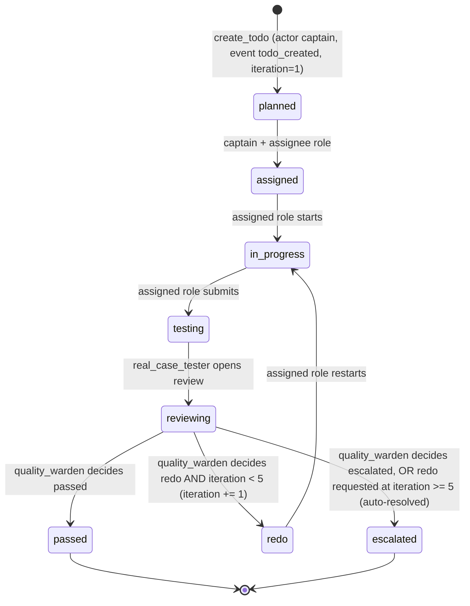
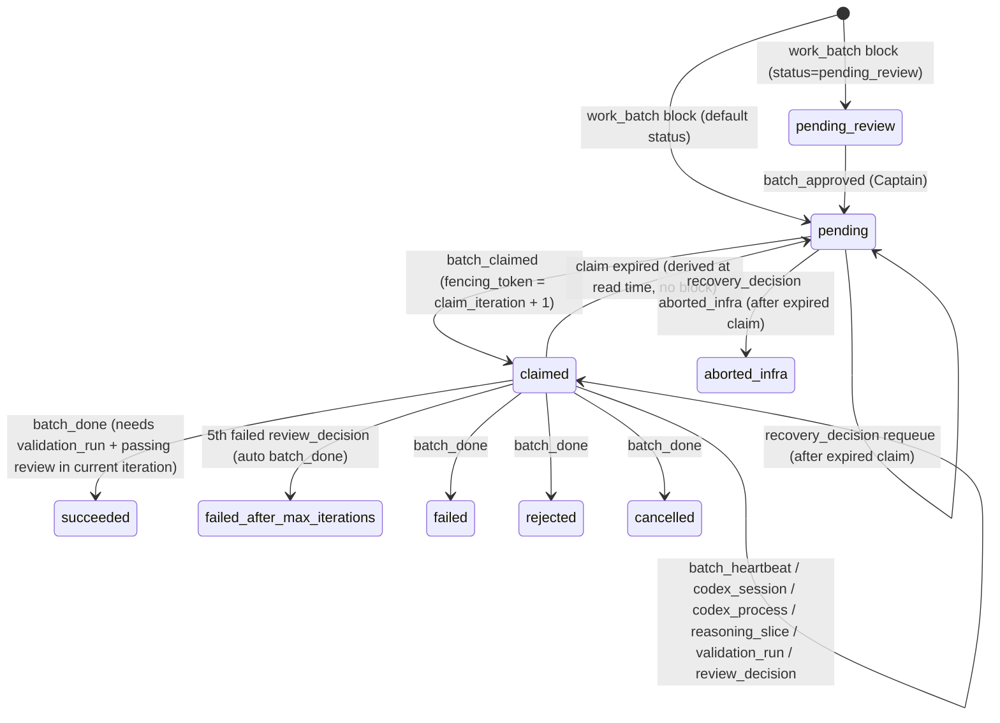
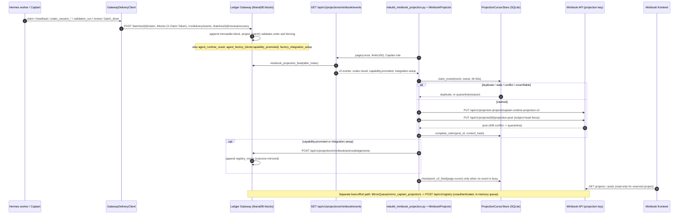

# 04 — Delivery lifecycle & Minibook projection

Part of the [architecture overview](00-overview.md).

Status: describes branch `feat/nebius-claude-sandbox` as read on 2026-10-12.
Code was read, not executed. Where code and specs disagree, **code wins** and
the disagreement is listed in [section 5](#5-implemented-vs-planned-code-wins).

## 1. Purpose & authority

The delivery part moves a unit of work (a *TODO* in the legacy model, a *work
batch* in the production model) from planning through build, real-case testing
and review to a terminal decision, and records every step as append-only
evidence.

Authority rules (enforced in code, not just prose):

- **The Ledger Gateway (MariaDB) is the only production source of truth**
  ([03](03-ledger-gateway.md)).
  `agenten/delivery/api.py` raises `"SQLite delivery ledger is legacy-import
  only; use GatewayDeliveryClient"`. The SQLite ledger survives only behind
  `legacy_api.py` and a migration script.
- **Lifecycle state is derived, never written.** `gateway.contracts.project_batch`
  folds the ordered child blocks of a `work_batch` into a `BatchProjection`.
  Workers append events and never set a `status` field.
- **Minibook is a projection, never command authority.** It receives redacted,
  allow-listed `captain.minibook-projection.v2` events from a pull feed. The
  reserved project `captain-runtime-projection-v2` is read-only for every
  caller except the holder of `MINIBOOK_PROJECTION_API_KEY`
  (`_forbid_reserved_projection_project`, `require_projector` in
  `minibook/src/main.py`). Projection failure never rolls back Gateway state.
  The only thing that flows back is an *acknowledgement*, which the Gateway
  records as a `registry_mirror` evidence event.
- **Review is independent and read-only.** `agenten/review` produces decisions
  from copies of plans and artifacts. A builder cannot review its own artifact
  (`ReviewerIndependenceError`).

## 2. Components (verified names)

| Component | Location | Role |
| --- | --- | --- |
| `DeliveryStatus`, `DeliveryRole`, `DeliveryTodo`, `DeliveryEvent` | [`agenten/delivery/models.py`](../../agenten/delivery/models.py) | Legacy TODO model: 8 statuses, 3 roles (`architect_builder`, `real_case_tester`, `quality_warden`; not the four factory roles of [05](05-agent-factory.md)), `max_iterations=5` |
| `LEGAL_TARGETS`, `validate_transition`, `resolved_target` | [`agenten/delivery/state_machine.py`](../../agenten/delivery/state_machine.py) | Pure transition rules and actor guards |
| `SqliteDeliveryLedger` | [`agenten/delivery/ledger.py`](../../agenten/delivery/ledger.py) | Legacy WAL SQLite store; optimistic `version`, idempotent `event_id` |
| `create_legacy_delivery_app` / `create_delivery_app` | [`legacy_api.py`](../../agenten/delivery/legacy_api.py), [`api.py`](../../agenten/delivery/api.py) | Legacy FastAPI (`/delivery/todos…`); the production factory refuses SQLite |
| `DeliveryEventPublisher` | [`agenten/delivery/events.py`](../../agenten/delivery/events.py) | Publishes legacy events to bus topic `delivery.events` |
| `GatewayDeliveryClient` | [`agenten/delivery/gateway_client.py`](../../agenten/delivery/gateway_client.py) | Typed client for claim, heartbeat, `/blocks`, `/v1/delivery/events`, review, recovery, `complete` |
| `GatewayCodexRunRepository`, `CodexCancellationCoordinator` | [`agenten/delivery/codex_runs.py`](../../agenten/delivery/codex_runs.py) | Codex session start/event/finish evidence and cancellation |
| `GatewayRecoveryService`, `RecoveryDecision` | [`agenten/delivery/recovery.py`](../../agenten/delivery/recovery.py) | Captain decision for expired claims (`requeue`) |
| `LocalCodexWorkerRecoveryDirector` | [`agenten/delivery/worker_recovery.py`](../../agenten/delivery/worker_recovery.py) | Terminalizes Codex sessions after proving the host process identity (`scripts/codex-session.ps1`) |
| `recovery_cli` (`main.py recover-gateway`) | [`agenten/delivery/recovery_cli.py`](../../agenten/delivery/recovery_cli.py) | One fail-closed recovery pass that needs `CAPTAIN_GATEWAY_TOKEN` |
| `GatewayReviewController`, `GatewayReviewDecision` | [`agenten/review/gateway_controller.py`](../../agenten/review/gateway_controller.py) | Validates a `passed`/`failed` decision with `artifact://` evidence refs |
| `PlanReviewProcess`, `ArtifactReviewProcess` | [`agenten/review/process.py`](../../agenten/review/process.py), [`artifacts.py`](../../agenten/review/artifacts.py) | Independent plan and artifact review; findings with severity `ERROR` produce `FAILED` |
| `MinibookProjectionEvent`, `_EVENT_CATALOG`, `MinibookProjectionAcknowledgementV1`, `MinibookProjectionRebuildReceiptV1` | [`agenten/delivery/minibook_events.py`](../../agenten/delivery/minibook_events.py) | v2 projection contract with a redacted allow-list payload |
| `MinibookProjector` | [`agenten/delivery/projector.py`](../../agenten/delivery/projector.py) | Claims, renders, upserts, deduplicates, reconciles and acknowledges |
| `ProjectionCursorStore` | [`agenten/delivery/projection_cursor.py`](../../agenten/delivery/projection_cursor.py) | Local SQLite: processed events, subject heads, claims, quarantine, feed cursor |
| `MinibookClient` | [`agenten/delivery/minibook_client.py`](../../agenten/delivery/minibook_client.py) | Minibook HTTP API (`/api/v1/...`) |
| `GatewayProjectionFeedClient`, `CaptainProjectionFeed` | [`projection_feed_client.py`](../../agenten/delivery/projection_feed_client.py), [`scripts/rebuild_minibook_projection.py`](../../scripts/rebuild_minibook_projection.py) | Paginated reader of the Gateway feed; the script runs incremental or `--full-rebuild` |
| Feed builders + `MirrorQueue` | [`gateway/registry_feed.py`](../../gateway/registry_feed.py), [`gateway/mirror.py`](../../gateway/mirror.py) | Map ledger blocks to v2 events; best-effort push to the Minibook registry |
| Minibook backend | [`minibook/src/main.py`](../../minibook/src/main.py), [`projection.py`](../../minibook/src/projection.py), [`models.py`](../../minibook/src/models.py) | FastAPI + SQLite; `ProjectionEventPost`, `ProjectionSubjectHead`, `ProjectionPostFence` |
| Minibook frontend | [`minibook/frontend/`](../../minibook/frontend/) | Next.js. Renders generic projects, posts and agents, with no projection-specific code |
| Minibook Forge | [`minibook/swarm/`](../../minibook/swarm/) (`api.py`, `job_store.py`, `scheduler.py`, `pipeline.py`) | Optional `/api/v1/creation-jobs`, enabled only with `MINIBOOK_CREATION_DB` |

## 3. Lifecycle

### 3a. Delivery item (TODO) — `agenten/delivery/state_machine.py`

Bounded repair: `iteration` starts at 1 and `max_iterations` is 5. A `redo`
requested while `iteration >= max_iterations` is rewritten to `escalated` by
`resolved_target`. The result is at most 5 review rounds and 4 `redo`
transitions. Every write requires `expected_version == version` and a unique
`event_id`, so replaying the same `event_id` returns the current TODO.
`append_evidence` and `renew_lease` are restricted to the assignee.

### 3b. Production work batch — `gateway/contracts.py::project_batch`

Bounded repair: a `review_decision` requires current-iteration `validation_run`
evidence, and its `evidence_refs` must be a subset of that run's
`artifact_ref`s. The Gateway (`GatewayStore._review_once`) appends
`batch_done: failed_after_max_iterations` when `failed_review_count == 5`.
`project_batch` rejects that outcome when fewer than five failed reviews exist.
A Codex session's `behavioral_repair_increment` is `1` only for
`behavioral_failure`. Infrastructure, cancellation and claim failures do not
consume a repair. The Agent Factory uses the same ceiling of 5
(`max_behavioral_iterations: Literal[5]`).

## 4. Dataflow

The Gateway accepts these delivery event types (`gateway.contracts.DeliveryEventType`):
`codex_task`, `codex_session`, `codex_session_started`, `codex_session_event`,
`codex_session_warning`, `codex_session_finished`, `artifact_built`, `deploy`,
`validation_run`, `repair_request`, `batch_done`, `e2e_run`, `evaluation`,
`release_decision`, `registry_mirror`, `hermes_skill_evaluation_requested`,
`hermes_skill_candidate_built`, `hermes_skill_test_recorded`,
`hermes_tool_gap_recorded`, `hermes_skill_evaluation_submitted`,
`hermes_skill_published`, `hermes_ready_to_use_validated`,
`captain_business_benchmark_validated`. Four worker events
(`hermes_skill_candidate_built`, `hermes_skill_test_recorded`,
`hermes_skill_evaluation_submitted`, `hermes_tool_gap_recorded`) need the
worker role. Four Captain events (`hermes_skill_evaluation_requested`,
`hermes_skill_published`, `hermes_ready_to_use_validated`,
`captain_business_benchmark_validated`) need the Captain role
(`HERMES_SKILL_EVENT_TYPES` / `CAPTAIN_SKILL_EVENT_TYPES` in `gateway/app.py`).

The v2 projection catalog (`_EVENT_CATALOG`) defines 10 types:
`plan.requested`, `plan.published`, `blueprint.published`, `codex.running`,
`codex.result`, `n8n.evidence`, `validation.recorded`, `replanning.requested`,
`capability.promoted`, `integration.setup`. **The Gateway feed currently emits
only three of them** (see [section 5](#5-implemented-vs-planned-code-wins)).

`MinibookProjector.reconcile` computes a `DriftReport` and, with `apply=True`,
retires duplicate, orphaned or v1-cutover posts. A full rebuild
(`--full-rebuild`) calls `begin_v2_full_rebuild`. The Gateway also exposes
`POST /api/v1/projections/minibook/rebuild-receipts`, which accepts
`MinibookProjectionRebuildReceiptV1` (consumed by the portal live contracts).

## 5. Implemented vs planned (code wins)

| Capability | State | Evidence |
| --- | --- | --- |
| 8-state TODO machine with actor guards and a 5-iteration ceiling | Implemented, **legacy only** | `state_machine.py`, `ledger.py`; tests `tests/delivery/test_delivery_ledger.py`, `test_sqlite_retirement_boundary.py` |
| SQLite → Gateway migration | Implemented (script) | `scripts/migrate_sqlite_delivery_ledger.py`, `tests/delivery/test_sqlite_delivery_migration.py` |
| Gateway batch lifecycle (approve, claim, fence, heartbeat, review, terminal) | Implemented | `gateway/contracts.py::project_batch`, `gateway/store.py`, `test_gateway_delivery_client.py` |
| Expired-claim recovery with process-proven Codex terminalization | Implemented (`requeue` only) | `recovery.py`, `worker_recovery.py`, `main.py recover-gateway`, `test_gateway_recovery.py`, `test_recovery_cli.py` |
| `aborted_infra` recovery decision | Contract only | Accepted by `RecoveryDecision` and `project_batch`; `GatewayRecoveryService` never emits it |
| Gateway review controller | Implemented, client-side only | `gateway_controller.py`, `tests/review/test_gateway_controller.py`. No production caller outside tests |
| Plan review gate | Implemented | `PlanReviewProcess`; consumed via `ReviewDecisionReader` in `agenten/execution/process.py` |
| Artifact review | Implemented, not wired | `ArtifactReviewProcess` has no importer outside `agenten/review` |
| v2 projection pipeline (feed, projector, cursor, ack, `registry_mirror`) | Implemented for 3 event types | `gateway/app.py` feed, `registry_feed.py`, `test_minibook_projector.py`, `test_minibook_rebuild.py`, live tests under `tests/live/` |
| Projection of plan/blueprint/codex.running/n8n/validation/replanning | **Planned** (catalog only) | `_EVENT_CATALOG` defines them; `minibook_projection_feed` selects only `agent_runtime_result`, `capability_promoted` and `factory_integration_setup` |
| Projection of tool gaps, iterations and failure reports (lifecycle spec) | **Planned** | `hermes_tool_gap_recorded` and `repair_request` are Gateway events with no projection template |
| Reserved projection project is read-only; dedicated projector key | Implemented | `require_projector`, `_forbid_reserved_projection_*`, `test_minibook_route_isolation.py` |
| Comments or mentions turn into Captain commands | **Not implemented** | No Minibook → Captain command path was found |
| Captain reads Minibook registry before building (07-17 §11) | **Not implemented** | No reader of `/api/v1/registry` in `agenten/` or `gateway/` |
| Minibook Forge creation jobs | Implemented, optional | `minibook/swarm/api.py`; client `agenten/agent_factory/minibook_forge.py` |

Contradictions between specs and code:

1. **Who commits the review decision.** The real-case spec (07-15, invariant 5)
   says "Quality Warden recommends; Captain commits". `validate_transition`
   requires `actor == quality_warden` for `reviewing → passed|redo|escalated`.
2. **Repair ceiling.** The 07-17 spec (§2.7, §9, §13, `retry_limit=3`) says to
   escalate after 3 behavioral repairs. The code uses 5: TODO
   `max_iterations=5`, Gateway `failed_review_count == 5`, Factory
   `max_behavioral_iterations: Literal[5]`. The 07-15 and 07-19 specs also say 5.
3. **Terminal vocabulary.** The 07-17 spec and the `DeliveryBatchDonePayload`
   envelope use `succeeded|failed|blocked|escalated`. The batch lifecycle
   (`BatchStatus`, `TerminalOutcome`) uses
   `succeeded|failed|rejected|cancelled|failed_after_max_iterations|aborted_infra`.
   No `blocked` or `escalated` batch state exists. This leaves two `batch_done`
   schemas under one name.
4. **`passed` requires real evidence (07-15, invariant 10).** The Gateway
   enforces this (`validation_run` plus a passing review). The legacy SQLite
   ledger does not check evidence on `reviewing → passed`.
5. **Minibook scope (07-17 §11, 07-19).** The specs promise projections of plans,
   assignments, reviews, evaluations, tool gaps and release decisions. The code
   projects only build results, capability promotions and integration setup.
   `MinibookProjector.upsert_plan`/`post_assignment` still write ordinary
   (non-v2) posts, used by `scripts/post_delivery_plan.py`.
6. **Second, non-durable mirror.** The 07-17 spec says "failed mirrors retry
   from the cursor". `MirrorQueue` is an in-memory `asyncio.Queue`, and it posts
   to the **unauthenticated** Minibook `POST /api/v1/registry`. When
   `eval_score` is missing, it defaults to 10.
7. **Defect: stranded batch (confirmed by code trace, not executed).**
   `project_batch` never resets `recovery_recorded` on a new `batch_claimed`
   (`gateway/contracts.py:1119-1133`), and it derives expiry only
   `if ... not recovery_recorded` (`contracts.py:1220`). After one requeue, a
   re-claimed batch whose second claim expires stays `claimed`. A new claim
   gets 409 (`gateway/store.py:6649`), Captain recovery gets 409 "claim is not
   expired" (`store.py:6413-6418`), heartbeats and evidence are refused because
   the token has expired, and `RecoveryWorker` scans only `pending`
   (`agenten/delivery/recovery.py:72`). Fix: reset `recovery_recorded` on
   `batch_claimed`, or compare `recovered_iteration == claim_iteration`, which
   is what `agenten/delivery/recovery.py:81-82` already does. The existing test
   (`tests/gateway/test_gateway.py:1217`) stops before the second expiry.
8. **Duplicated schema.** `minibook/src/projection.py::ProjectionEventV2`
   re-implements `MinibookProjectionEvent` without importing it, by design,
   because Minibook is independently runnable. The two catalogs can drift
   silently.

## 6. Interfaces to other parts

- **Gateway / ledger ([03](03-ledger-gateway.md)):** all production writes go through
  `GatewayDeliveryClient` (bearer token, plus `X-Claim-Token` for fenced block
  writes). Lifecycle derivation is in `gateway/contracts.py`, and persistence
  and the role split are in `gateway/store.py` and `gateway/app.py`.
- **Codex execution / supervision ([06](06-coding-execution.md)):** `codex_runs.py` records
  `codex_session_started|event|warning|finished`.
  `agenten/execution/codex_supervisor.py` sets `behavioral_repair_increment`.
  Recovery shells out to `scripts/codex-session.ps1` (PowerShell 7).
- **Agent Factory / Hermes skills ([05](05-agent-factory.md)):** the factory state machine
  (`agenten/agent_factory/state_machine.py`) produces `agent_factory_block`
  promotions, which become `capability.promoted`. Hermes skill events share the
  delivery event envelope. Forge is reached through
  `MinibookForgeHttpClient` → `/api/v1/creation-jobs`.
- **Integration portal (08-05 spec; operations in [07](07-operations-live-demo.md)):** `factory_integration_setup` blocks
  become `integration.setup` projections with only `integration_status` and
  counts, and no secrets. Rebuild receipts feed `gateway/portal_live_contracts.py`.
- **Planning / execution ([01](01-captain-planning.md), [06](06-coding-execution.md)):** `agenten/execution/process.py` refuses execution
  unless a `PlanReview` resolves to `PASSED`.
- **Event bus ([02](02-event-runtime.md)):** the legacy `DeliveryEventPublisher` publishes to
  `delivery.events` through `agenten.runtime.event_bus.EventBus`.

## 7. Sources

Code: [`agenten/delivery/`](../../agenten/delivery/),
[`agenten/review/`](../../agenten/review/),
[`gateway/contracts.py`](../../gateway/contracts.py),
[`gateway/store.py`](../../gateway/store.py),
[`gateway/app.py`](../../gateway/app.py),
[`gateway/registry_feed.py`](../../gateway/registry_feed.py),
[`gateway/mirror.py`](../../gateway/mirror.py),
[`minibook/src/`](../../minibook/src/), [`minibook/swarm/`](../../minibook/swarm/),
[`scripts/rebuild_minibook_projection.py`](../../scripts/rebuild_minibook_projection.py),
[`main.py`](../../main.py).

Tests: [`tests/delivery/`](../../tests/delivery/), [`tests/review/`](../../tests/review/),
`tests/gateway/test_minibook_integration_rebuild.py`,
`tests/live/test_minibook_projection_live.py`.

Specs:
[2026-07-15 real-case Hermes team](../superpowers/specs/2026-07-15-real-case-hermes-team-design.md),
[2026-07-17 gateway-native delivery runtime](../superpowers/specs/2026-07-17-gateway-native-delivery-runtime-design.md),
[2026-07-19 Hermes–Minibook–Captain lifecycle](../superpowers/specs/2026-07-19-hermes-minibook-captain-lifecycle-design.md),
[2026-08-05 self-service integration portal](../superpowers/specs/2026-08-05-self-service-integration-portal-design.md).
