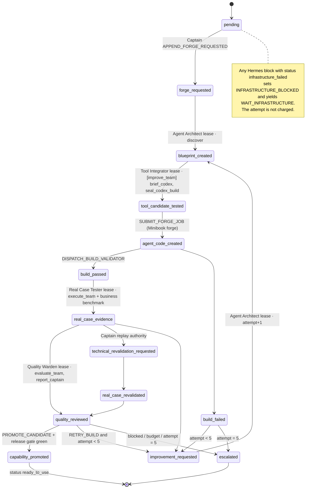
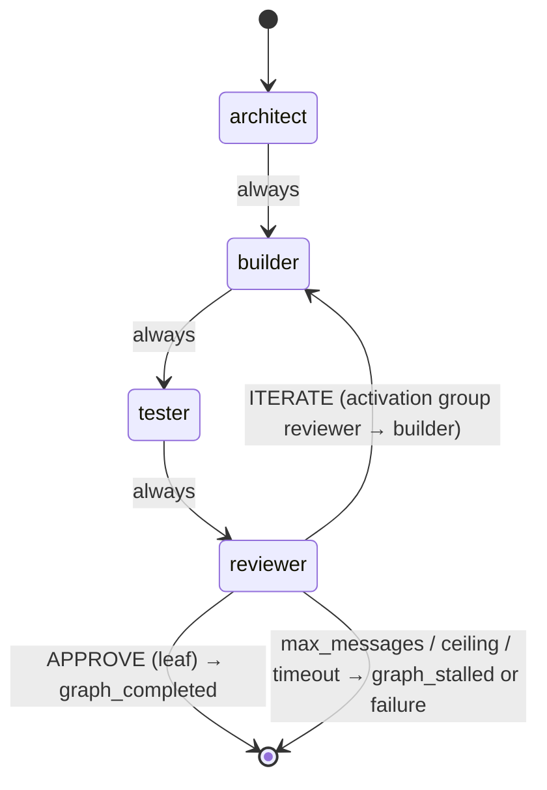
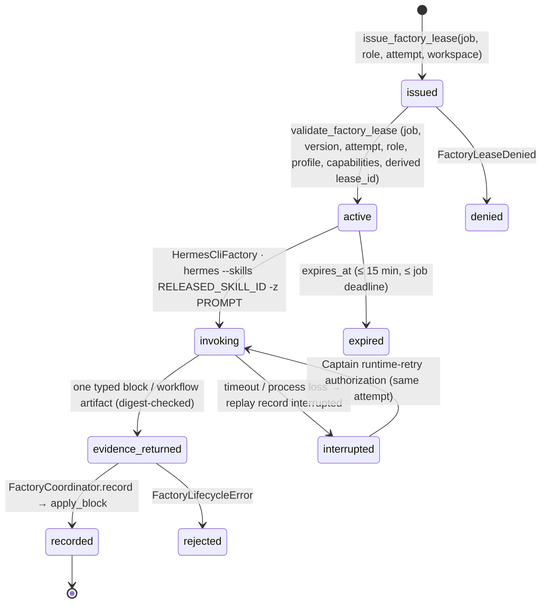
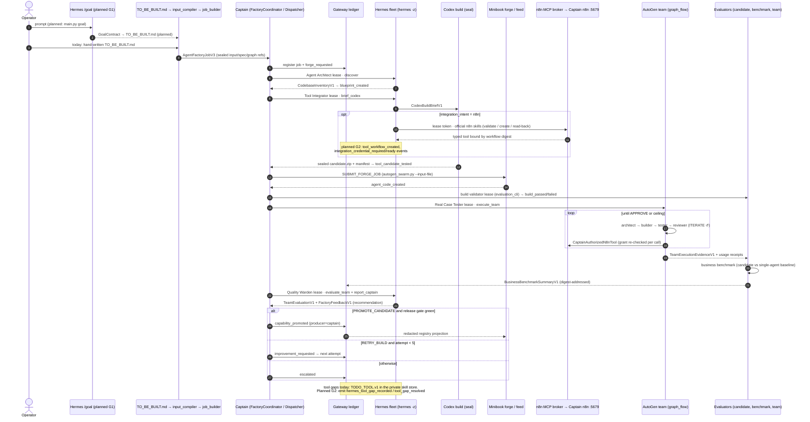

# 05 — Agent factory, Hermes fleet and AutoGen teams

Part of the [architecture overview](00-overview.md).

Status: as of branch `feat/nebius-claude-sandbox` at `6ec2e0e` (2026-10-12).
Where code and specs disagree, this page follows the code. Disagreements are
flagged with **⚠**.

## 1. Purpose and authority

The Agent Factory turns a sealed, structured `TO_BE_BUILT.md` into a promoted,
reusable AutoGen agent team. Captain owns the whole lifecycle. It creates the
job, issues one short-lived lease per Hermes role and attempt, validates every
evidence block, runs the deterministic gates, and is the only actor that can
append `capability_promoted`. Promotion is what makes a team `ready_to_use`.

| Actor | May do | May not do |
| --- | --- | --- |
| Captain (`FactoryCoordinator`, `FactoryDispatcher`, Gateway) | issue leases, append Captain phases (`forge_requested`, `improvement_requested`, `technical_revalidation_requested`, `capability_promoted`, `escalated`), evaluate release | delegate release authority |
| Hermes fleet (4 roles via `hermes -z`) | run exactly one released skill step per lease and return one typed evidence block or artifact | publish skills, widen leases, write the ledger, claim `ready_to_use` |
| AutoGen candidate team (Swarm, Selector, RoundRobin, GraphFlow, single agent) | reason, hand off, and call only the tools in its sealed manifest | grant itself tools, decide its own release |
| Codex / Claude Code builders | change code inside the leased workspace | commit, push, or activate n8n workflows unless the job says so |
| Minibook | show the read-only registry projection after promotion | act as lifecycle authority |

Two checks in the code enforce this. `FactoryEvidenceBlock.require_phase_authority`
rejects role phases that Hermes did not produce under a lease. It also rejects
Captain phases that carry a role or lease
([contracts.py](../../agenten/agent_factory/contracts.py)). `apply_block`
refuses `capability_promoted` unless every acceptance assertion has been
observed and the release decision, workflow evaluation, feedback and business
benchmark all match ([state_machine.py](../../agenten/agent_factory/state_machine.py)).
The AutoGen team cannot release itself, and neither can Hermes's recommendation
(`PROMOTE_CANDIDATE`).

## 2. Components

| Component (verified name) | Location | Role |
| --- | --- | --- |
| `AgentFactoryJob` / `AgentFactoryJobV2` / `AgentFactoryJobV3`, `parse_factory_job` | `agent_factory/contracts.py` | Versioned job. V3 adds `FactoryExecutionPolicyV1` (mode `demo`/`release`, `max_cost_usd`, `required_live_runs`, `allowed_models`, `sandbox_mode`). `max_behavioral_iterations` is `Literal[5]` |
| `FactoryRole`, `FactoryPhase`, `FactoryEvidenceBlock`, `FactoryLease` | `agent_factory/contracts.py` | 4 roles, 13 phases, append-only block schema `captain.agent-factory-block.v1` |
| `issue_factory_lease`, `validate_factory_lease`, `FactoryLeasePort`, `FACTORY_LEASE_DURATION` (15 min) | `agent_factory/leases.py` | Fail-closed role leases. The lease ID is derived from its authority, and a lease never outlives the job deadline |
| `FactoryProjection`, `apply_block`, `next_action`, `FactoryActionKind` | `agent_factory/state_machine.py` | Pure lifecycle; exactly one allowed next side effect |
| `FactoryCoordinator`, `FactoryRepository` | `agent_factory/service.py`; Gateway adapter `gateway/factory_repository.py` | Rebuilds the projection before every append |
| `FactoryDispatcher`, `HermesFactoryPort`, `MinibookForgePort`, `FactoryBusinessBenchmarkPort` | `agent_factory/orchestration.py` | Turns `next_action` into a leased dispatch |
| `HermesCliFactory`, `HermesCliSettings`, `FilesystemFactorySkillReplayStore` | `agent_factory/hermes_cli.py` | Hermes fleet adapter: one non-interactive `hermes … --skills <id> -z <prompt>` per step (line ~1378), with an idempotent replay store |
| `SkillSequencePolicy`, `FactorySkillStep`, `FactoryImprovementAuthorizationV1`, `FactoryRuntimeRetryAuthorizationV1` | `agent_factory/skill_sequence.py`, `skill_workflow_contracts.py` | Maps role and attempt to released skill steps |
| Skills `captain-factory-{discover,brief-codex,seal-codex-build,execute-team,evaluate-team,improve-team,report-captain}`, `autogen-agent-factory`, bundle `captain-agent-factory-loop` | `agent_factory/skills/` | Versioned skill sources; each invocation is bound to the skill's digest |
| `FactoryCandidateManifest`, `FactoryAutoGenTeamManifestV1`, `FactoryGraphSpecV1`, `FactoryGraphEdgeV1` | `agent_factory/candidate_evaluation.py` | Sealed candidate (`captain.factory-candidate.v1`) and closed-topology team manifest (`autogen-team.v1`) |
| `build_graph_flow`, `verdict_condition` | `agent_factory/graph_flow_team.py` | Declarative `DiGraphBuilder`/`GraphFlow`; edges are `always` / `approve` / `iterate` only |
| `HostAutoGenSessionExecutor`, `HostAutoGenTeamRunner`, `TeamExecutionService`, `CaptainAuthorizedN8nTool`, `BudgetedChatCompletionClient`, `compose_live_team_execution` | `agent_factory/team_execution.py` | Builds and runs the AutoGen team from the sealed manifest, with budgeted model calls and n8n grants rechecked on every call |
| `TeamEvaluationService`, `FactoryFeedbackBuilder`, `ImprovementBuilder` | `team_evaluation.py`, `factory_feedback.py`, `improvement.py` | Deterministic-first evaluation, one recommendation, a bounded child-candidate assignment |
| `evaluate_factory_release`, `evaluate_factory_workflow_release`, `FactoryReleaseDecision` | `agent_factory/release_gate.py` | Legacy rule: a recovery run, then 3 consecutive successful normal E2E runs. V3 rule: exactly `required_live_runs` runs, a release-complete budget, and a passed benchmark |
| `BusinessBenchmarkEvaluator`, `BusinessBenchmarkSummaryV1`, policy (90% correctness, cost ≤ 125%, latency ≤ 150% of baseline) | `agent_factory/business_benchmark*.py` | Candidate compared with a single-agent baseline on a private suite |
| `codex_build_execution.py`, `codex_build_recovery.py` (`scaffold_ready` → `implementation_*` → `sealed`) | `agent_factory/` | Codex build, sealing and resumable recovery |
| `ToolGapMarker` (`TODO_TOOL.v1`), `HermesSkillEvaluationRequest`, `ReleasedHermesSkill` | `agent_factory/skill_evaluation.py` | Tool gaps (`required`/`optional`, `unresolved`/`resolved`) |
| `TypedN8nTool`, `OpaqueN8nToolReference`, `TypedN8nCatalog`, `resolve_tool_gap_n8n_option` | `agent_factory/n8n_tools.py` | Typed n8n tools. There is no generic workflow-ID executor |
| `IntegrationCredentialRequirementV1`, `IntegrationSetupStatus`, `IntegrationSetupPlanner`, `require_required_integrations_ready` | `agent_factory/integration_setup.py` | n8n credential requirements (`missing` … `ready`); aliases only, never secret values |
| `McpLeaseIssuer`, `create_mcp_broker_app` | `agent_runtime/n8n_mcp_broker.py` | Lease-token reverse proxy to the n8n instance MCP |
| `resolve_n8n_endpoint`, `build_capability_scoped_n8n_reference` | `agent_runtime/n8n_endpoint.py` | `captain-builder` mode. Port `15678` (VibeMind) is refused |
| `N8nTarget`, `N8nHttpClient` | `agenten/targets/n8n.py` | Typed n8n deployment and execution with verified provider evidence |
| `AgentRuntimeControlPlane`, `SwarmOrchestrator`, `RuntimeToolset`, `CapabilityProfile` | `agenten/agent_runtime/` | Runtime tools `hermes.plan`, `hermes.design_agent`, `codex.*`; profiles `factory-*` and `n8n-builder` |
| `AgentFarmEvaluationService`, `CaptainEvaluationSociety` | `agenten/evaluation/` | Society-of-Mind input evaluation (planning only) |
| `compose_business_demo_factory_operator`, `run_business_demo_factory_jobs` | `gateway/agent_factory_live_operator.py` | Gateway-owned live composition for the business-demo jobs; supports `stop_before_quality_warden` |

## 3. Lifecycle

### 3.1 Factory job and candidate team

Diagram source: `_allowed_next_phases` and `next_action` in `state_machine.py`.

The improvement loop is bounded twice: `max_behavioral_iterations: Literal[5]`
on the job and `attempt ≤ 5` on leases and blocks. `apply_block` raises
"behavioral iteration ceiling reached" when a sixth attempt is requested.
Infrastructure failures and Codex runtime interruptions resume the same
attempt through `FactoryRuntimeRetryAuthorizationV1` and do not consume an
iteration.

Inside `execute_team`, a `graph_flow` candidate runs a verdict loop
(`graph_flow_team.py`). `verdict_condition` matches only when the first line of
the reviewer's message is exactly `APPROVE` or `ITERATE`. The run terminates on
`MaxMessageTermination | _FactoryActivityCeilingTermination` or on an
`asyncio.wait_for` timeout. Manifest validation also rejects `task_completed`
for `graph_flow`, so a stray `TERMINATE` cannot bypass the loop.

### 3.2 Hermes role lease

The four Hermes roles (`FactoryRole`) and their profiles: Agent Architect
(`agent_architect`, `factory-architect`), Tool Integrator (`tool_integrator`,
`factory-tool-integrator`), Real Case Tester (`real_case_tester`,
`factory-real-case-tester`) and Quality Warden (`quality_warden`,
`factory-quality-warden`). Only a Tool Integrator lease with
`integration_intent=n8n` is upgraded to `n8n-builder`, and any other role
asking for n8n is rejected.

## 4. Dataflow (prompt → release)

Steps marked *planned* come from the goal-driven builder spec (G1/G2). They do
not exist in code yet.

## 5. Implemented vs planned

| Capability | State | Evidence |
| --- | --- | --- |
| Job V1–V3, leases, evidence blocks, state machine, coordinator | Implemented | `contracts.py`, `leases.py`, `state_machine.py`, `service.py` |
| Hermes fleet: one-shot `hermes -z` per leased skill step, replay store, runtime retry | Implemented | `hermes_cli.py`, `skill_sequence.py`, `gateway/factory_hermes_retry_authority.py` |
| Skill set | Implemented. **⚠** Code has 7 steps including `seal_codex_build`; spec and `bundle.yaml` list 6 | `skill_workflow_contracts.py:FactorySkillStep`, `skills/captain-agent-factory-loop/bundle.yaml` |
| Swarm / Selector / RoundRobin / single agent | Implemented | `team_execution.py` |
| `graph_flow` team with APPROVE/ITERATE edges | Implemented early, in M1a (commits `ff9ff30`, `e984cf3`, `8263417`). **⚠** The spec put it in G1 | `graph_flow_team.py`, `candidate_evaluation.py:110,174` |
| GraphFlow extras from spec §4: `save_state`/`load_state` resume, `TokenUsageTermination`/`ExternalTermination`, tool-name edge conditions, `output_content_type=Verdict` | Planned / not found. Code uses `MaxMessageTermination`, activity ceiling, timeout and `BufferedChatCompletionContext` | grep in `agent_factory/` |
| Business benchmark gate (claims and renewal profiles) | Implemented, offline. Live runs are opt-in | `business_benchmark*.py`, `state_machine.py` V3 promotion checks |
| Codex build recovery phases | Implemented | `codex_build_recovery.py` |
| Typed n8n tools, lease-token MCP broker, `captain-builder` endpoint | Implemented | `n8n_tools.py`, `n8n_mcp_broker.py`, `n8n_endpoint.py`, `docker-compose.captain-n8n.yml` |
| n8n credential requirements + release block | Implemented (n8n only) | `integration_setup.py` |
| `TODO_TOOL.v1` gaps blocking release | Implemented (private skill store) | `skill_evaluation.py`, `release_gate.py`, `skill_store.py` |
| `hermes_tool_gap_recorded` delivery event | Contract only. Accepted by the Gateway but nothing in the repo emits it | `gateway/contracts.py:613`, `gateway/app.py:227` |
| `claude_code_build` / `sandbox_run_tests` with `AgentGoalV1` | Implemented in `agenten/coding_agent/` (M1a). **Not wired** into factory team tools | no references from `agent_factory/` or `gateway/` |
| G1: `main.py goal`, Hermes `/goal` binding, GoalContract → `TO_BE_BUILT.md`, `goal_ref` on the job, goal judge reading Gateway state | **Planned** | no `goal` subcommand in `main.py`; no `GoalContract`/`goal_ref` outside the submodule |
| G2: `tool_workflow_created`, `tool_gap_resolved`, `integration_credential_required`, `integration_credential_ready`, `ExternalCredentialRequirementV1`, n8n workflow auto-creation per tool | **Planned** | none of these symbols exist |
| Live provider / n8n / Hermes evidence | Not claimed by this page | runbook §Recording evidence handoff |

## 6. Interfaces to other parts

- **Gateway and ledger ([03](03-ledger-gateway.md)):** the sole writer of factory blocks, benchmark
  summaries, budget projections and release decisions (`gateway/factory_repository.py`,
  `gateway/release_policy.py`). `FactoryRepository` is the port it implements.
- **Agent runtime control plane:** the factory reuses `CapabilityProfile`,
  `IntegrationIntent`, `ArtifactRef` and the n8n broker from `agent_runtime/`.
  The swarm-facing runtime tools (`codex.*`, `hermes.*`) are separate from the
  factory dispatch path.
- **Coding agent and provider proxy (Nebius, [06](06-coding-execution.md)):** `AgentGoalV1` and
  `ClaudeCodeBuildTool` (`agenten/coding_agent/`) are the intended builder tool
  for graph_flow teams. Wiring them in is still open (see §5).
- **Minibook ([04](04-delivery-minibook.md)):** `MinibookSwarmForge` submits sealed input to
  `minibook/autogen_swarm.py`. The registry feed receives only post-promotion
  projections.
- **n8n ([07](07-operations-live-demo.md)):** only the Captain-owned builder instance on loopback `:5679`, reached
  through `N8N_MODE=captain-builder`. The VibeMind n8n is never targeted.
- **Capability assembly / live demo ([07](07-operations-live-demo.md)):** `gateway/capability_*` and
  `agent_factory/capability_live_*` drive factory jobs from the portal.
- **`hermes-agent/` submodule:** used as an external CLI only. It is never
  modified.

## 7. Contradictions found

1. **Skill count:** the six-skill spec and `bundle.yaml` list 6 skills, but the
   code adds `captain-factory-seal-codex-build` as step 7, and `SkillSequencePolicy`
   requires it by default.
2. **graph_flow timing:** the goal-builder spec §9 places `graph_flow` in G1,
   but it shipped in M1a. Its termination and resume details differ from spec §4
   (see §5).
3. **Factory input:** the runbook says `input.md` is the canonical input.
   `load_factory_input` accepts only a file named `TO_BE_BUILT.md`. Both files
   exist in the repository root (see also
   [01 §5.1](01-captain-planning.md#51-spec--code-contradictions), items 3 and 7).
4. **Tool resolution order:** the six-skill spec lists 8 steps (including local
   code and AutoGen components). `autogen-agent-factory/SKILL.md` lists 6.
5. **`hermes_tool_gap_recorded`:** the goal-builder spec says it "exists but is
   never emitted". That is confirmed: gaps go only to the private skill store.

## 8. Sources

- Code: [agent_factory/](../../agenten/agent_factory/),
  [agent_runtime/](../../agenten/agent_runtime/),
  [targets/n8n.py](../../agenten/targets/n8n.py),
  [evaluation/](../../agenten/evaluation/),
  [agent_factory_live_operator.py](../../gateway/agent_factory_live_operator.py),
  [coding_agent/](../../agenten/coding_agent/)
- Runbook: [AGENT_FACTORY_RUNBOOK.md](../AGENT_FACTORY_RUNBOOK.md)
- Specs: [agent runtime control plane](../superpowers/specs/2026-07-17-agent-runtime-control-plane-design.md),
  [AgentFarm input evaluation](../superpowers/specs/2026-07-18-agentfarm-input-evaluation-design.md),
  [Captain n8n builder](../superpowers/specs/2026-07-18-captain-n8n-builder-design.md),
  [Hermes skill evaluation](../superpowers/specs/2026-07-20-hermes-skill-evaluation-design.md),
  [six-skill factory](../superpowers/specs/2026-07-21-captain-hermes-six-skill-factory-design.md),
  [business benchmark gate](../superpowers/specs/2026-07-26-business-benchmark-gate-design.md),
  [Codex factory recovery](../superpowers/specs/2026-07-30-codex-factory-recovery-design.md),
  [goal-driven agent builder](../superpowers/specs/2026-09-30-goal-driven-agent-builder-design.md)
- Plans: [M1a goal coding core](../superpowers/plans/2026-10-01-m1a-goal-coding-core.md),
  [M1b follow-ups](../superpowers/plans/2026-10-07-m1b-followups-from-m1a.md)
