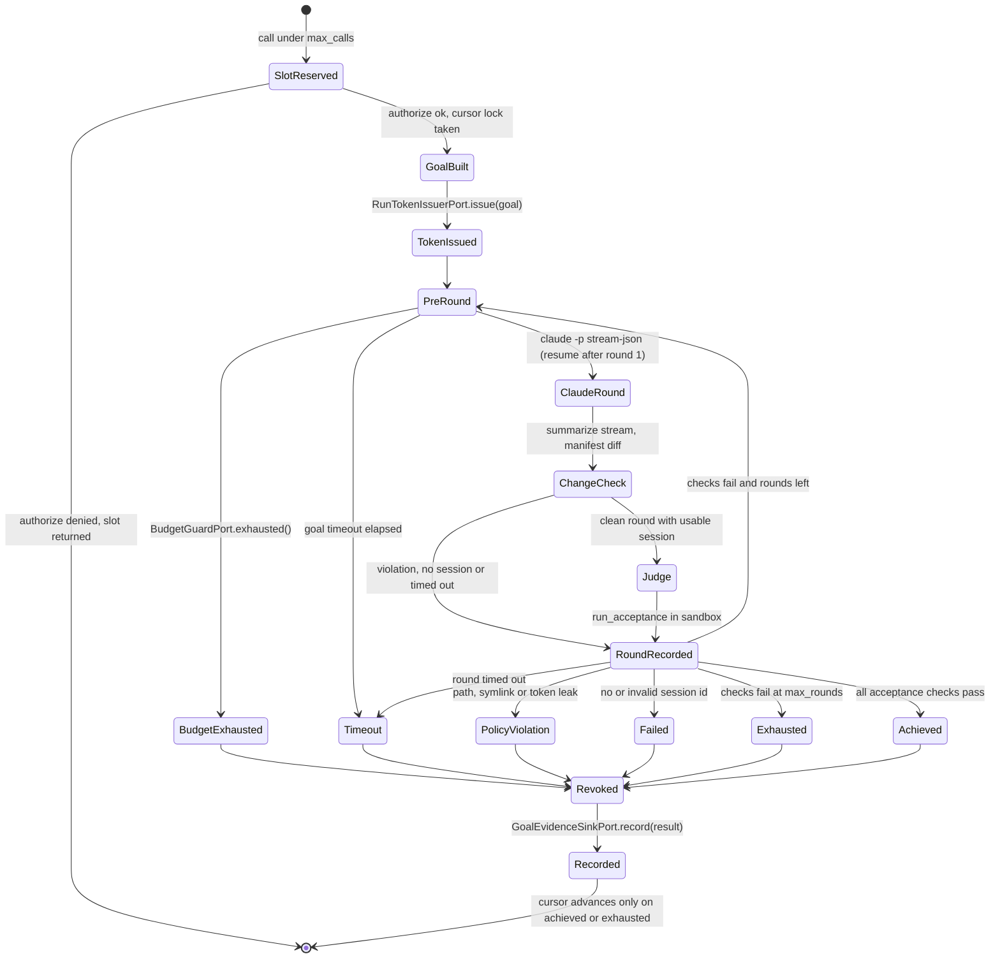
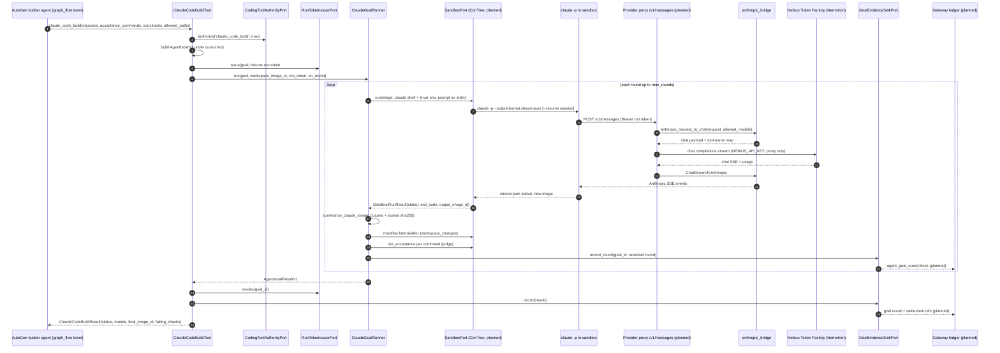

# 06 — Coding execution: Codex supervisor → Claude Code in a Token Factory sandbox

Part of the [architecture overview](00-overview.md).

Status as of 2026-10-12, branch `feat/nebius-claude-sandbox`. Code is the
authority; where specs or plans disagree with code, the code statement wins and
the disagreement is flagged in [section 5](#5-implemented-vs-planned).

## 1. Purpose and authority

This part turns a coding request from an AutoGen team agent into verified code
changes in an isolated workspace. It is in the middle of a migration:

- **Legacy path (still live):** `CodexSupervisor` launches the Codex CLI on the
  host under `CodexExecutionPolicy`, journals its JSONL output, and reports
  through the Gateway. Model calls go through the loopback Responses budget
  proxy to OpenAI.
- **Target path (core built offline, not wired yet):** Claude Code CLI runs
  inside a sandbox (Nebius Token Factory / ConTree microVM). It reaches NVIDIA
  Nemotron only through a Captain relay in the provider proxy.

Authority rules in the target path, as enforced by
[`agenten/coding_agent/`](../../agenten/coding_agent/):

- **Claude Code is a production tool, not a decider.** AutoGen agents call it
  through `claude_code_build`. Claude's own success claim is ignored. A goal is
  `achieved` only when the goal's `acceptance_commands` pass in a separate
  sandbox run (`run_acceptance`). The `AgentGoalResultV1` validator enforces
  this invariant.
- **The coding tool never releases anything.** It moves a `WorkspaceCursor` to a
  new sandbox image and nothing more. Promotion and the release gate stay with
  the Captain/Gateway (see the goal-driven spec, section 3, and
  [05](05-agent-factory.md)).
- **Every call is authorized and capped.** `CodingToolAuthorityPort.authorize`
  runs on every call. Each tool has a per-team call ceiling (`max_calls`), and
  `CodingToolLimits` sets the goal bounds (rounds ≤ 10, turns ≤ 200,
  budget ≤ 50 USD, timeout 60–7200 s).
- **Secrets.** The sandbox receives exactly six environment variables
  (`build_claude_env`): `ANTHROPIC_BASE_URL`, `ANTHROPIC_AUTH_TOKEN` (the
  per-goal run token), `ANTHROPIC_MODEL`, `ANTHROPIC_SMALL_FAST_MODEL`,
  `CLAUDE_CODE_DISABLE_NONESSENTIAL_TRAFFIC=1` and `DISABLE_TELEMETRY=1`.
  `NEBIUS_API_KEY` never enters the sandbox: on the relay path it exists only
  in the proxy (direct LLM clients and the Hermes child process get it through
  their own environment, see §6 and
  [07 §4](07-operations-live-demo.md#4-dataflow-processes-ports-environment-and-secrets)),
  and `config/llm_provider.py` keeps it out of `repr`. The run token is kept out of `SandboxCommand.repr`. It is
  redacted from recorded commands, output tails, changed paths and session IDs.
  A session ID or path that contains the token counts as a `policy_violation`.
  The token is revoked in a `finally` block when the goal ends. Redaction is
  defense in depth only. The real control is a short-lived token bound to the
  goal's budget, which is still M1b work.

## 2. Components

| Area | Module | Verified names | Role |
|---|---|---|---|
| Legacy | [`agenten/execution/codex_supervisor.py`](../../agenten/execution/codex_supervisor.py) | `CodexSupervisor`, `PowerShellCodexRunner`, `CodexRunRequest`, `CodexRunResult`, `CodexOutputJournalPolicy`, `GatewayCodexEvidenceWriter` | Gateway-fenced Codex process supervision, journal limits, cancellation |
| Legacy | [`agenten/execution/codex_policy.py`](../../agenten/execution/codex_policy.py) | `CodexExecutionPolicy`, `AuthorizedCodexRun`, `FrozenEnvironment`, `CodexPolicyViolation` | Local launch authorization with an environment allowlist (includes `OPENAI_API_KEY`) |
| Legacy | [`agenten/execution/codex_events.py`](../../agenten/execution/codex_events.py) | `parse_codex_jsonl`, `CodexProcessEvent`, `CodexParseWarning` | Secret-safe Codex JSONL parsing |
| Shared gate | [`agenten/execution/process.py`](../../agenten/execution/process.py) | `ExecutionProcess`, `ExecutionRequest`, `BuildExecutor`, `PackageExecutionResult` | Fail-closed execution gate for reviewed canonical plans. **Not Codex-specific**, so M6 does not delete it |
| Contracts | [`agenten/coding_agent/contracts.py`](../../agenten/coding_agent/contracts.py) | `AgentGoalV1` (`captain.agent-goal.v1`), `AcceptanceCheckV1`, `AcceptanceReportV1`, `AgentGoalRoundV1`, `AgentGoalResultV1` (`captain.agent-goal-result.v1`), `GoalStatus`, `path_allowed` | Frozen pydantic goal, round and result contracts |
| Stream | [`agenten/coding_agent/claude_stream.py`](../../agenten/coding_agent/claude_stream.py) | `parse_claude_stream_line`, `summarize_claude_stream`, `AgentEventV2`, `ClaudeRunSummary`, `ClaudeStreamTooLargeError` | Reduces `stream-json` to lifecycle, counts and SHA-256 (10 MiB cap, content not kept) |
| Sandbox port | [`agenten/coding_agent/sandbox.py`](../../agenten/coding_agent/sandbox.py) | `SandboxPort.run(image_id, SandboxCommand) -> SandboxRunResult`, `SandboxProtocolError` | One shell command on an image produces a new image. **No real adapter yet** |
| Judge | [`agenten/coding_agent/acceptance.py`](../../agenten/coding_agent/acceptance.py) | `run_acceptance`, `workspace_changes`, `workspace_manifest`, `protected_paths`, `unsafe_symlinks`, `SymlinkEntry` | Acceptance runs after a cache purge. Changes are detected by a sha256 manifest diff, not by `git status`. Protected judge files and unsafe symlinks are denied |
| Prompts | [`agenten/coding_agent/goal_prompt.py`](../../agenten/coding_agent/goal_prompt.py) + [`prompts/`](../../agenten/coding_agent/prompts/) | `render_goal_prompt`, `render_resume_prompt`; `claude_goal_v1.md`, `claude_resume_v1.md` | Versioned templates for the first round and the resume rounds |
| Runner | [`agenten/coding_agent/goal_runner.py`](../../agenten/coding_agent/goal_runner.py) | `ClaudeGoalRunner`, `ClaudeRunnerSettings`, `BudgetGuardPort`, `build_claude_shell`, `build_claude_env` | Goal loop: rounds, change policy, acceptance, `--resume` |
| Tools | [`agenten/coding_agent/tools.py`](../../agenten/coding_agent/tools.py) | `ClaudeCodeBuildTool` (`claude_code_build`), `SandboxRunTestsTool` (`sandbox_run_tests`), `WorkspaceCursor`, `CodingToolLimits`, `CodingToolAuthorityPort`, `RunTokenIssuerPort`, `GoalEvidenceSinkPort` | AutoGen `BaseTool`s, slot accounting, cursor lock, token issue and revoke, evidence hooks |
| Relay | [`agenten/provider_proxy/anthropic_bridge.py`](../../agenten/provider_proxy/anthropic_bridge.py) | `anthropic_request_to_chat`, `ChatStreamToAnthropic`, `chat_completion_to_anthropic`, `short_tool_name`, `BridgeError`, `UpstreamFormatError` | Pure Anthropic Messages ↔ chat-completions translation (no I/O) |
| Budget proxy | [`agenten/provider_proxy/app.py`](../../agenten/provider_proxy/app.py), [`service.py`](../../agenten/provider_proxy/service.py), [`transports.py`](../../agenten/provider_proxy/transports.py) | `create_provider_proxy_app`, `ProviderBudgetProxy`, `OpenAIResponsesHTTPClient`, `GatewayProviderSettlementHTTPClient` | Today: loopback **Responses** API for Codex only, pinned to `api.openai.com` |
| Provider config | [`config/llm_provider.py`](../../config/llm_provider.py) | `resolve_provider`, `ProviderProfile`, `NEBIUS_BASE_URL`, `NEMOTRON_DEFAULT_MODEL`, `NEMOTRON_SMALL_MODEL` | Resolves Nebius (default), `openai` or `custom` for direct LLM users (M0) |

## 3. Lifecycle

### 3.1 One `claude_code_build` goal

This diagram follows `ClaudeCodeBuildTool.run` and `ClaudeGoalRunner.run`.

Notes from the code:

- `on_round` → `GoalEvidenceSinkPort.record_round` fires after **every** round,
  before the status decision. Spent rounds are therefore recorded even when a
  later round raises.
- If the runner raises, the token is still revoked, but `record(result)` is
  skipped. If `revoke` raises, its exception replaces the result. Both cases
  are listed in M1b.
- The cursor also advances on `exhausted`, so the team can build on partial
  progress. It does not advance on `policy_violation`, `failed`, `timeout` or
  `budget_exhausted`.
- The pre-round budget check uses only `BudgetGuardPort.exhausted()`. The
  runner does not compare spend against `goal.budget_usd` itself (R12). That
  cap is meant to be enforced by a budget-bound run token in the proxy (M1b).

### 3.2 Migration milestones

| # | Content (spec §7 / goal spec §9) | Status |
|---|---|---|
| S1–S4 | Spike: Token Factory models, Claude → relay → Nemotron locally, ConTree capabilities, Claude in ConTree | **Pending.** No `2026-09-29-nebius-spike-findings.md` exists, and the model IDs in `llm_provider.py` are marked "pending confirmation by the S1 spike" |
| M0 | Provider switch to Nebius/Nemotron | **Done** (code and commits) |
| M1a | Offline coding core + pure relay translation + `graph_flow` | **Done** (code and tests) |
| M1b | ConTree adapter, Nebius chat transport, `/v1/messages` route, run tokens, fresh judge image, ledger evidence | **Pending** (checklist only) |
| G1/G2 | `main.py goal`, Hermes `/goal`, tool resolution, credential events | **Pending.** Only `graph_flow` was pulled forward into M1a |
| M2 | Gateway v2 (`agent.*`, `agent_session_*`, v2 receipts; codex v1 moves to `legacy`) | **Pending.** `agenten/legacy/` does not exist |
| M3 | Runtime `agent.*` → core; delete `runtime_codex.py` | **Pending** |
| M4 | Delivery `codex_runs.py` → core | **Pending** |
| M5 | Factory `BRIEF_AGENT`/`SEAL_AGENT_BUILD`; delete `codex_build_*` | **Pending** |
| M6 | Delete `agenten/execution/codex_*`, `codex_config.py`, Responses transport, `codex-session.ps1` | **Pending** |
| M7 | Docs (`ARCHITECTURE.md`, `WORKSTREAMS.md`, `AGENTS.md`, README) | **Pending.** This page is a partial contribution |
| D | Hosting on a Nebius VM (Compose, TLS, configurable bind) | **Pending** (separate spec, not written) |

## 4. Dataflow (target path)

Participants and steps marked *planned* have no implementation on this branch
(see section 5).

`sandbox_run_tests` follows the same authorize → cursor-lock → `run_acceptance`
path without calling an LLM, and it never advances the cursor.

## 5. Implemented vs planned

| Item | State | Evidence |
|---|---|---|
| M0 provider resolution (Nebius default, rejects OpenAI model IDs under Nebius, `custom` for the Claude shim) | Implemented | `config/llm_provider.py`; commits `087b92f`…`e14e2de` |
| Goal contracts, stream parser, sandbox port, acceptance/manifest diff, prompts, runner, tools | Implemented, offline | `agenten/coding_agent/*`; `tests/coding_agent/test_*.py` with `fakes.py`; commits `87d44cf`…`57ad617` |
| Anthropic ↔ chat translation (strict tool pairing, 64-char tool-name hashing, fail-closed upstream parsing) | Implemented, pure | `anthropic_bridge.py`; `tests/provider_proxy/test_anthropic_bridge_{request,response}.py` |
| `graph_flow` team pattern | Implemented | `agenten/agent_factory/graph_flow_team.py`, `team_execution.py` |
| Concrete `SandboxPort` (ConTree), PREPARE/workspace upload, base image | Planned (M1b) | No adapter outside tests |
| `RunTokenIssuerPort` / `GoalEvidenceSinkPort` / `CodingToolAuthorityPort` / `BudgetGuardPort` adapters | Planned (M1b) | Protocols only; nothing outside `agenten/coding_agent/` and its tests imports the package |
| `POST /v1/messages`, `/v1/messages/count_tokens`, `POST /v1/captain/run-tokens` | Planned (M1b) | `app.py` exposes only `/v1/responses*` and `/v1/captain/provider-settlements/finalize` |
| Nebius chat transport, Nebius price card / `RuntimeProviderPolicyV2` | Planned (M1b) | `transports.py` has only `OpenAIResponsesHTTPClient`, pinned to `api.openai.com`. `contracts.py` has only `OpenAIPriceCardV1` / `RuntimeProviderPolicyV1` |
| Fresh judge image, mode-change detection, trusted manifest tools | Planned (M1b) | `acceptance.py` docstring: "The judge still runs in the agent-modified image" |
| Ledger `agent_goal_round` blocks | Planned (M1b) | No occurrence in non-doc code |
| Spike S1–S4 | Pending | No findings file. Model IDs unconfirmed |
| Codex removal M2–M6 | Pending | `codex_supervisor.py`, `runtime_codex.py`, `codex_build_execution.py`, `delivery/codex_runs.py`, `codex_config.py` are all present |

**Disagreements (code wins):**

1. **Runner name.** The specs call it `ClaudeSandboxRunner`. The code has
   `ClaudeGoalRunner`. There is no separate `ClaudeSandboxRunner` and no
   `AgentRunRequest v2` / `AgentRunReceipt v2`.
2. **Prompt location.** The goal-driven spec §5 names
   `agenten/agent_factory/prompts/claude_goal_v1.md`. The template actually
   lives in `agenten/coding_agent/prompts/`.
3. **Result shape.** The spec's `AgentGoalResultV1` has `final_image`,
   `acceptance_report` and `settlement_refs`. The code has `final_image_id`, a
   per-round `acceptance`, and **no settlement refs**. `GoalStatus` adds
   `exhausted` and `policy_violation`, which the spec does not list.
4. **Judge isolation.** The spec says acceptance runs "unabhängig" (independent)
   as its own ConTree operation. It is a separate sandbox run, but it runs on
   the agent-modified image. Independence is therefore partial until the fresh
   judge image arrives (M1b).
5. **Change detection.** The spec's COLLECT step uses `git status`/`diff`. The
   code uses a sha256 manifest diff (commit `d843ac9`). `.git` is excluded.
6. **Budget per goal.** The spec binds `budget_usd` to the goal. The runner
   ignores `budget_usd` and checks only `BudgetGuardPort.exhausted()`.
7. **Plan checkboxes.** In the M0 plan and the M1a plan, every step checkbox is
   still `[ ]`, although the git log shows both as implemented. The plans do
   not record progress.
8. **Model IDs.** `config/llm_provider.py` hard-codes the Nemotron Super/Nano
   IDs with `tool_calling=True`. The code comment says these values are not
   confirmed by the spike. The spike plan's Global Constraints treat them as
   S1-confirmed.
9. **Provider proxy doc.** [`docs/provider-budget-proxy.md`](../provider-budget-proxy.md)
   correctly describes only the Codex/Responses proxy. Nothing in it covers
   the relay yet.

## 6. Interfaces to other parts

- **Agent factory / team execution ([05](05-agent-factory.md)):** The team should register `ClaudeCodeBuildTool`
  and `SandboxRunTestsTool` on Builder/Tester agents in `graph_flow` teams.
  This is not wired yet. The tools share a `WorkspaceCursor` per team run, and
  the goal ID is `<goal_prefix>-build-<n>`.
- **Gateway / ledger ([03](03-ledger-gateway.md)):** The Gateway is the target for `GoalEvidenceSinkPort`
  (`agent_goal_round` and the goal result) and for run-token authority (via the
  runtime-finalize channel). Legacy Codex evidence goes through
  `GatewayCodexEvidenceWriter`. Production ledger writes go only through the
  Gateway.
- **Provider proxy ↔ Gateway ([03](03-ledger-gateway.md), [07](07-operations-live-demo.md)):** The provider proxy reads Gateway authority back
  before each provider effect and submits one provider settlement per run (see
  [`provider-budget-proxy.md`](../provider-budget-proxy.md)). The relay keeps
  this budget model.
- **Runtime / delivery ([04](04-delivery-minibook.md), [05](05-agent-factory.md)):** `agenten/agent_runtime/runtime_codex.py` (`codex.*`
  operations) and `agenten/delivery/codex_runs.py` are the current consumers of
  `CodexSupervisor`. They move to `agent.*` and `agent_session_*` in M3/M4.
- **LLM clients ([01](01-captain-planning.md), [02](02-event-runtime.md)):** Planner, judge, decomposer, Hermes, LLM householders and
  evaluation resolve their endpoint through `config.llm_provider.resolve_provider`
  and call Token Factory directly. They do not use the relay.
- **Hermes ([05](05-agent-factory.md)):** Hermes goal drafting and the goal judge feed `AgentGoalV1`
  creation (G1). The goal judge reads Gateway promotion status and does not
  read Claude output.

## 7. Sources

- Specs: [`2026-09-29-nebius-codex-replacement-design.md`](../superpowers/specs/2026-09-29-nebius-codex-replacement-design.md),
  [`2026-09-30-goal-driven-agent-builder-design.md`](../superpowers/specs/2026-09-30-goal-driven-agent-builder-design.md)
- Plans: [`2026-09-29-nebius-spike-and-provider-switch.md`](../superpowers/plans/2026-09-29-nebius-spike-and-provider-switch.md),
  [`2026-10-01-m1a-goal-coding-core.md`](../superpowers/plans/2026-10-01-m1a-goal-coding-core.md),
  [`2026-10-07-m1b-followups-from-m1a.md`](../superpowers/plans/2026-10-07-m1b-followups-from-m1a.md)
- Docs: [`provider-budget-proxy.md`](../provider-budget-proxy.md), [`ARCHITECTURE.md`](../ARCHITECTURE.md)
- Code: [`agenten/coding_agent/`](../../agenten/coding_agent/),
  [`agenten/execution/`](../../agenten/execution/),
  [`agenten/provider_proxy/`](../../agenten/provider_proxy/),
  [`config/llm_provider.py`](../../config/llm_provider.py)
- Tests: [`tests/coding_agent/`](../../tests/coding_agent/),
  [`tests/provider_proxy/`](../../tests/provider_proxy/)
