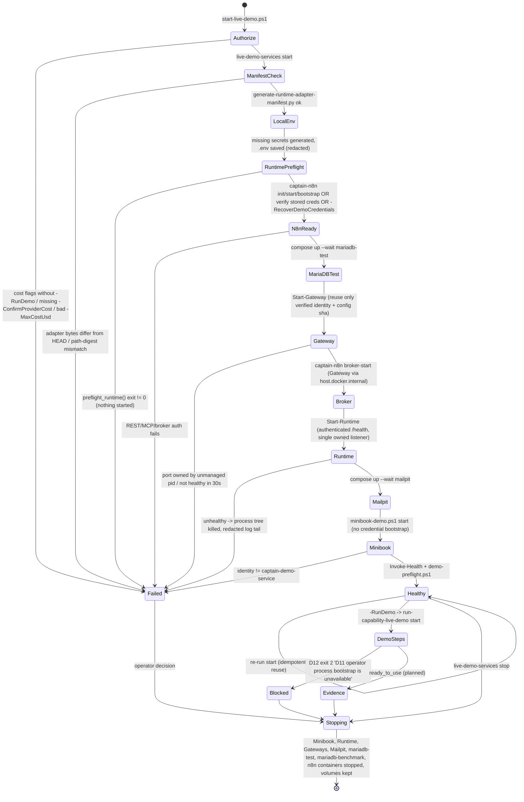
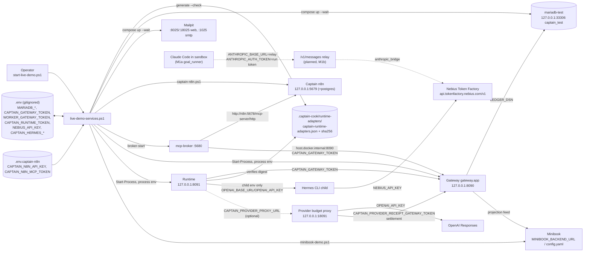

# 07 — Operations, local services and live demo

Part of the [architecture overview](00-overview.md).

> Scope: Docker Compose stacks, the live-demo service lifecycle
> (`scripts/live-demo-services.ps1`), the canonical live-demo entrypoint, the
> D12 capability-demo operator, MCP setup, provider budget proxy deployment,
> the runtime adapter manifest digest, verification scripts and the hosting
> plan (D). Verified against branch `feat/nebius-claude-sandbox` on 2026-10-12.
> Where prose and code disagree, **code wins** and the disagreement is flagged
> with ⚠.

## 1. Purpose and ownership

This part brings the Captain runtime up on one Windows workstation, checks that
it is healthy and authenticated, and runs the provider-backed demo. A paid run
only happens when the operator explicitly asks for one. It also holds the
off-box deploy scripts (Mini-PC portal, controlled provider VM) and the
submission checks.

Ownership rules (from [AGENTS.md](../../AGENTS.md) and the specs, checked against code):

| Resource | Owner | Rule |
| --- | --- | --- |
| Mailpit (`captain-cook` project) | Captain | Started and stopped by Captain scripts |
| MariaDB: `mariadb` (ledger volume), `mariadb-test` (`captain_test`, tmpfs), `mariadb-benchmark` (named volume) | Captain | Stopped only. Volumes are never removed |
| Captain n8n builder (`captain-n8n-builder`: postgres, n8n, mcp-broker) | Captain (in code) | Started and bootstrapped by `captain-n8n.ps1`, stopped by label filter, volumes kept |
| VibeMind n8n (`vibemind-n8n`, `:15678`, volume `voice_vibemind-n8n-data`) | VibeMind | Never adopted, migrated, restarted or deleted by Captain |
| Volumes in general | — | **Never `docker compose down -v`.** No script in this part calls `down` |

⚠ **Ownership drift.** AGENTS.md says Captain owns only Mailpit and MariaDB and
that "VibeMind owns the external n8n deployment". The live-demo code does not
use VibeMind n8n at all. It creates, bootstraps and stops its own n8n stack,
`captain-n8n-builder` on port 5679 with Postgres and an MCP broker on 5680. Only
[MCP_SETUP.md](../MCP_SETUP.md), [DEVPOST_CHECKLIST.md](../DEVPOST_CHECKLIST.md)
and the 2026-07-15 local-delivery-stack spec still point at VibeMind's `:15678`.

## 2. Components

| Component | Kind | Location | Notes |
| --- | --- | --- | --- |
| `captain-cook` stack | Compose | [docker-compose.yml](../../docker-compose.yml) | `mailpit` (axllent/mailpit:v1.29.6, 127.0.0.1:8025/1025), `mariadb` (11.8.8, `ledger`, needs `MARIADB_PASSWORD`/`MARIADB_ROOT_PASSWORD`), `n8n` under profile `owned-n8n` (5678). Used by `setup.ps1` |
| `captain-cook-test-<checkout>` | Compose | [docker-compose.test.yml](../../docker-compose.test.yml) | `mariadb-test`, DB `captain_test`, port `MARIADB_TEST_PORT` (33306), **tmpfs** data. One project name per checkout |
| `captain-cook-business-benchmark` | Compose | [docker-compose.benchmark.yml](../../docker-compose.benchmark.yml) | `mariadb-benchmark` on 33316, persistent volume |
| `captain-n8n-builder` | Compose | [docker-compose.captain-n8n.yml](../../docker-compose.captain-n8n.yml) | `postgres:16-alpine`, `n8n` 2.29.10 on `CAPTAIN_N8N_PORT` (5679), `mcp-broker` (profile, [Dockerfile.captain-mcp-broker](../../Dockerfile.captain-mcp-broker), 5680) |
| Service lifecycle | pwsh | [scripts/live-demo-services.ps1](../../scripts/live-demo-services.ps1) | Actions `start`, `status`, `health`, `stop`, `portal-start`, `gateway-restart`, `benchmark-start`, `benchmark-restart` |
| Managed process identity | pwsh lib | [scripts/managed-process-identity.ps1](../../scripts/managed-process-identity.ps1) | Schema `captain.managed-process-identity.v1`: pid, start time, executable, `configuration_sha256` |
| n8n builder helper | pwsh | [scripts/captain-n8n.ps1](../../scripts/captain-n8n.ps1) | `init`, `start`, `bootstrap`, `broker-start`, `status`, `stop`. Runs `docker compose config --quiet` |
| Minibook helper | pwsh | [scripts/minibook-demo.ps1](../../scripts/minibook-demo.ps1) | `start`, `bootstrap`, `status`, `stop`. Identity `captain-demo-service`. URL from `MINIBOOK_BACKEND_URL` or `minibook/config.yaml` |
| Demo preflight | pwsh | [scripts/demo-preflight.ps1](../../scripts/demo-preflight.ps1) | Normalises `.env`, checks n8n REST/MCP, Mailpit, Minibook, Gateway and MariaDB TCP |
| Canonical entrypoint | pwsh | [scripts/start-live-demo.ps1](../../scripts/start-live-demo.ps1) | Infra only by default. `-RunDemo -ConfirmProviderCost -MaxCostUsd` for a paid run |
| Capability wrapper | pwsh | [scripts/run-capability-live-demo.ps1](../../scripts/run-capability-live-demo.ps1) | `start` → `capability-demo.ps1 run`, `verify` → `status`. Budget range 0.03–6.00 USD |
| D12 operator | pwsh + Python | [scripts/capability-demo.ps1](../../scripts/capability-demo.ps1), [agenten/demo_orchestrator/](../../agenten/demo_orchestrator/cli.py) | `init`, `start`, `status`, `run`, `resume`, `stop`. Exit codes 2 (config/authority) and 124 (timeout) |
| One-shot A2 entrypoint | Python | [agenten/agent_factory/live_demo_entrypoint.py](../../agenten/agent_factory/live_demo_entrypoint.py), `main.py live-demo-a2` | Release envelope → Hermes → Runtime HTTP → Gateway state and projection feed. Writes redacted JSON |
| Gateway | Python | `gateway.app` (host fixed to `127.0.0.1`, port 8090) | Health at `/healthz` |
| Agent Runtime | Python | `agenten.agent_runtime.runtime_entrypoint` (127.0.0.1:8091) | Authenticated `/health`. `preflight_runtime()` runs before any service starts |
| Adapter manifest generator | Python | [scripts/generate-runtime-adapter-manifest.py](../../scripts/generate-runtime-adapter-manifest.py) | Schema `captain.runtime-adapters.v1` over `agenten/agent_runtime/captain_production_adapters.py` |
| Provider budget proxy | Python | [scripts/run_provider_budget_proxy.py](../../scripts/run_provider_budget_proxy.py) → `agenten/provider_proxy/entrypoint.py` | 127.0.0.1:18091, SQLite budget plus CAS, upstream OpenAI Responses |
| Anthropic↔chat bridge | Python | `agenten/provider_proxy/anthropic_bridge.py` | Pure translation for Claude Code → Nebius. No route uses it yet |
| Hermes endpoint mapping | Python | `agenten/agent_factory/hermes_endpoint.py` | `CAPTAIN_HERMES_BASE_URL` plus `NEBIUS_API_KEY` become child-only `OPENAI_BASE_URL`/`OPENAI_API_KEY` |
| Dev MCP helpers | Python | [scripts/captain_artifact_mcp.py](../../scripts/captain_artifact_mcp.py), [scripts/claude_code_openai_shim.py](../../scripts/claude_code_openai_shim.py) | stdio artifact MCP (`CAPTAIN_ARTIFACT_ROOT`), and an OpenAI-compatible shim on :8114 for Hermes |
| Guided setup | pwsh | [setup.ps1](../../setup.ps1), `scripts/setup/*.psm1` | Existing or owned n8n (`--profile owned-n8n`). Never removes volumes |
| Off-box deploys | pwsh + Compose | `scripts/deploy-portal-mini-pc.ps1`, `deploy-mini-pc-edge.ps1`, `deploy-controlled-provider.ps1`, `deploy/*` | Dry run by default, `-Apply` to change anything. See [OPERATIONS.md](../OPERATIONS.md) |
| Submission check | Python | [scripts/verify_submission.py](../../scripts/verify_submission.py) | Required files plus `artifacts/demo-run.json` (`success`, `problem_id`, `done_count`, `blocks`) |

## 3. Lifecycle of the live-demo service stack

This is the order in `Invoke-StartServices`, `Invoke-Health` and the `stop`
branch of `live-demo-services.ps1`, wrapped by `start-live-demo.ps1`.

Points that hold for every state:

- **Process probes.** Gateway and Runtime are reused, replaced or killed only
  when four things match: the PID file, its process start time, the executable
  path and a SHA-256 of the configuration (`captain.gateway.configuration.v2`,
  `captain.runtime.configuration.v1`). Exactly one listener must exist on
  127.0.0.1, and it must be owned by the managed launcher or its exact child
  running `-m gateway.app` / `-m agenten.agent_runtime.runtime_entrypoint`. An
  unmanaged owner fails with a refusal and nothing is killed. If the
  configuration changes, the managed Gateway is replaced
  (`Get-ManagedListenerIdentityForConfigurationReplacement`).
- **Redaction.** Console lines say `(values redacted)`. When the Runtime fails
  to start, the script replaces the values of 18 secret keys in its log tail
  with `***`, including `NEBIUS_API_KEY`, `CAPTAIN_HERMES_API_KEY` and the
  DSNs. Evidence files `.captain-cook/evidence/live-demo-services.json` and
  `portal-services.json` hold only schema, time, status, service names and
  `secrets: redacted`.
- **Cleanup.** `stop` uses `docker compose stop` and `docker stop` by label,
  and `taskkill /T` on verified PIDs. Because `mariadb-test` uses tmpfs, the
  `captain_test` ledger is **lost** on stop even though no volume is removed.

## 4. Dataflow: processes, ports, environment and secrets

Rules on how secrets move:

- `live-demo-services.ps1` reads `.env` through an **allow-list**, generates
  any missing secret with 32 random bytes encoded as base64url, and puts the
  values into the process environment. Values are never echoed.
- The Nebius key reaches Hermes only through `hermes_endpoint_overrides`, as
  child-process environment. `os.environ` is never changed.
- The proxy refuses to start unless `OPENAI_API_KEY`, the proxy client token,
  the receipt token and the runtime token are all present, and all are
  **pairwise distinct** from each other and from the Gateway and Worker tokens.
- The D12 `init` step writes eight distinct authorities to
  `.captain-cook/live-demo/private/demo.env`. A name that appears in both that
  file and the root `.env` is rejected.

## 5. Implemented vs planned

| Capability | Status | Evidence |
| --- | --- | --- |
| Captain-only service lifecycle (start, health, stop) with volume preservation | Implemented | `live-demo-services.ps1`; `tests/test_live_demo_operations.py::test_live_demo_services_only_operates_captain_resources` |
| Managed PID, listener and config identity | Implemented | `managed-process-identity.ps1`; `test_managed_*identity*` tests |
| Runtime adapter manifest digest bound to committed `HEAD` bytes | Implemented | `generate-runtime-adapter-manifest.py` (`git show HEAD:`, atomic write, `--check`) |
| Fail-closed paid authorisation (`-RunDemo -ConfirmProviderCost -MaxCostUsd`, invariant culture) | Implemented | `start-live-demo.ps1`; `tests/test_start_live_demo.py` |
| Nebius key forwarded to Runtime and redacted | Implemented | commit `c1654ea`; `test_services_forward_and_redact_the_hermes_endpoint_secrets` |
| One-shot A2 (`main.py live-demo-a2`) | Implemented (requires a real release envelope) | `live_demo_entrypoint.py`, `main.py` |
| D12 `init` / `stop` | Implemented | `agenten/demo_orchestrator/cli.py`, `tests/demo_orchestrator/` |
| D12 `start` / `status` / `run` / `resume` | **Blocked** (exit 2) | `gateway.capability_assembly_bootstrap` does not exist, so `require_operator_process_bootstrap()` always raises. `start` and `status` also hit an unconditional `DemoConfigurationError` after that check (`agenten/demo_orchestrator/cli.py:59-67`, `configuration.py:189,222-232`), so adding the module alone does not unblock them |
| Three-input capability live demo with recovery, three E2E traces and restart/resume | Planned | 2026-08-08 spec; blocked by D11 |
| Provider budget proxy (OpenAI Responses, `gpt-5.6-terra`) | Implemented, started manually | `run_provider_budget_proxy.py`, [provider-budget-proxy.md](../provider-budget-proxy.md). Not started by `live-demo-services.ps1` |
| Claude Code → Nebius relay `/v1/messages`, run-token issuer | Planned (M1b) | Only the bridge plus its tests exist. [m1b follow-ups](../superpowers/plans/2026-10-07-m1b-followups-from-m1a.md) |
| Portal and Mini-PC deploy, controlled provider VM | Implemented (dry run by default) | [OPERATIONS.md](../OPERATIONS.md), `deploy/` |
| Hosting (D): Nebius VM with Compose (MariaDB, Gateway, Proxy, Minibook), reverse proxy and TLS, configurable bind address | **Planned** | [Nebius spec §7](../superpowers/specs/2026-09-29-nebius-codex-replacement-design.md). The Gateway and Runtime hosts are hard-coded to `Literal["127.0.0.1"]`, and there is no hosting spec or compose file yet |
| Guided Windows setup | Implemented | `setup.ps1`, `scripts/setup/`, `scripts/acceptance/setup-smoke.ps1` |
| Submission check | Implemented | `verify_submission.py`, `tests/test_verify_submission.py` |

Contradictions (code wins):

1. ⚠ **n8n ownership.** See §1. The live demo runs its own
   `captain-n8n-builder` on port 5679, not VibeMind on 15678.
   [MCP_SETUP.md](../MCP_SETUP.md) and
   [DEVPOST_CHECKLIST.md](../DEVPOST_CHECKLIST.md) are stale.
2. ⚠ **Mailpit port.** Compose defaults `MAILPIT_WEB_PORT` to 8025.
   `demo-preflight.ps1` forces 18025 into `.env` and probes 18025. On a
   checkout whose `.env` lacks 18025, the first `start` publishes 8025, then
   fails health on 18025.
3. ⚠ **Minibook port.** `demo-preflight.ps1` defaults `MINIBOOK_BACKEND_URL` to
   `:8080`. The 2026-08-08 spec says Minibook listens on 3456 and must not
   carry a second hard-coded port. `minibook-demo.ps1` resolves the port
   correctly.
4. ⚠ **CAPABILITY_LIVE_DEMO.md** documents `-LiveProviders`,
   `-MaxCostUsdPerInput`, `-RecordVideo` and `-RecordingWindowTitle` for
   `run-capability-live-demo.ps1`. The script takes only a positional
   `start|verify`, `-ConfirmProviderCost` and `-MaxCostUsd`. As a result,
   `start-live-demo.ps1 -RecordingWindowTitle …` forwards a parameter that the
   wrapper does not declare.
5. ⚠ **`start-live-demo.ps1` comment** says the service helper "runs docker
   compose config during its start action". Only `captain-n8n.ps1` does that.
   `live-demo-services.ps1` never validates `docker-compose.yml` or
   `docker-compose.test.yml`.
6. ⚠ **Restart/resume claims and tmpfs.** `captain_test` lives on tmpfs, so
   `stop` loses all ledger state. Resume is only meaningful across Gateway
   restarts, not across a full `stop`/`start`.
7. ⚠ **MCP_SETUP.md / proxy doc vs Nebius direction.** The docs and the proxy
   entrypoint are OpenAI/Codex-centric (`gpt-5.6-terra`, `CODEX_HOME`). The
   branch direction is Claude Code plus Nebius (spec M6 deletes the Codex
   proxy path). Both coexist today.
8. Minibook is started twice, once in `Invoke-StartServices` and again in
   `start-live-demo.ps1`. This is harmless because start is idempotent.

## 6. Interfaces to other parts

- **Gateway / ledger ([03](03-ledger-gateway.md)).** Reached at `/healthz`, `LEDGER_DSN` →
  `captain_test`. Provides runtime state, the projection feed, provider
  settlement (`/v1/captain/provider-settlements/finalize` runs on the proxy and
  posts to the Gateway) and `/v1/capability-assemblies` for D12.
- **Agent runtime ([05](05-agent-factory.md)).** `runtime_entrypoint` with `preflight_runtime()`,
  `CAPTAIN_RUNTIME_ADAPTER_MANIFEST(_SHA256)` and bearer `/health`.
- **Agent factory / Hermes ([05](05-agent-factory.md)).** `live_demo_entrypoint`, the released-skill
  catalog and `hermes_endpoint_overrides`.
- **Coding agent / sandbox ([06](06-coding-execution.md)).** `ClaudeRunnerSettings.relay_url`, the run
  token and the planned relay plus budget binding at the proxy.
- **Provider / LLM config ([06](06-coding-execution.md), [01](01-captain-planning.md)).** `config/llm_provider.py` (`NEBIUS_BASE_URL`,
  `nvidia/Nemotron-3-Super-120b-a12b` default).
- **Minibook (adjacent product, [04](04-delivery-minibook.md)).** Projection and read-back over HTTP. The
  identity is `captain-demo-service`.
- **n8n integration ([05](05-agent-factory.md)).** Captain n8n REST, `/mcp-server/http` and the MCP
  broker bound to the selected Gateway.

## 7. Sources

- Compose: [docker-compose.yml](../../docker-compose.yml), [docker-compose.test.yml](../../docker-compose.test.yml), [docker-compose.benchmark.yml](../../docker-compose.benchmark.yml), [docker-compose.captain-n8n.yml](../../docker-compose.captain-n8n.yml), [Dockerfile.captain-mcp-broker](../../Dockerfile.captain-mcp-broker)
- Scripts: [live-demo-services.ps1](../../scripts/live-demo-services.ps1), [start-live-demo.ps1](../../scripts/start-live-demo.ps1), [run-live-demo.ps1](../../scripts/run-live-demo.ps1), [demo-preflight.ps1](../../scripts/demo-preflight.ps1), [managed-process-identity.ps1](../../scripts/managed-process-identity.ps1), [captain-n8n.ps1](../../scripts/captain-n8n.ps1), [minibook-demo.ps1](../../scripts/minibook-demo.ps1), [capability-demo.ps1](../../scripts/capability-demo.ps1), [run-capability-live-demo.ps1](../../scripts/run-capability-live-demo.ps1), [generate-runtime-adapter-manifest.py](../../scripts/generate-runtime-adapter-manifest.py), [run_provider_budget_proxy.py](../../scripts/run_provider_budget_proxy.py), [verify_submission.py](../../scripts/verify_submission.py), [deploy-controlled-provider.ps1](../../scripts/deploy-controlled-provider.ps1)
- Code: [live_demo_entrypoint.py](../../agenten/agent_factory/live_demo_entrypoint.py), [hermes_endpoint.py](../../agenten/agent_factory/hermes_endpoint.py), [demo_orchestrator/cli.py](../../agenten/demo_orchestrator/cli.py), [demo_orchestrator/configuration.py](../../agenten/demo_orchestrator/configuration.py), [provider_proxy/entrypoint.py](../../agenten/provider_proxy/entrypoint.py), [provider_proxy/anthropic_bridge.py](../../agenten/provider_proxy/anthropic_bridge.py), [coding_agent/goal_runner.py](../../agenten/coding_agent/goal_runner.py), [main.py](../../main.py)
- Docs: [LIVE_DEMO_RUNBOOK.md](../LIVE_DEMO_RUNBOOK.md), [OPERATIONS.md](../OPERATIONS.md), [MCP_SETUP.md](../MCP_SETUP.md), [CAPABILITY_LIVE_DEMO.md](../CAPABILITY_LIVE_DEMO.md), [capability-demo-orchestrator.md](../capability-demo-orchestrator.md), [DEVPOST_CHECKLIST.md](../DEVPOST_CHECKLIST.md), [provider-budget-proxy.md](../provider-budget-proxy.md), [runtime-composition live proof](../operations/2026-08-19-runtime-composition-live-proof.md)
- Specs: [live-demo recovery start](../superpowers/specs/2026-08-08-live-demo-recovery-start-design.md), [guided Windows setup](../superpowers/specs/2026-07-15-guided-windows-setup-design.md), [Devpost demo readiness](../superpowers/specs/2026-07-15-devpost-demo-readiness-design.md), [local delivery stack](../superpowers/specs/2026-07-15-local-delivery-stack-design.md), [Nebius Codex replacement (Plan D)](../superpowers/specs/2026-09-29-nebius-codex-replacement-design.md)
- Tests: `tests/test_live_demo_operations.py`, `tests/test_start_live_demo.py`, `tests/test_capability_live_demo_script.py`, `tests/demo_orchestrator/`, `tests/provider_proxy/`, `tests/test_captain_n8n_stack.py`, `tests/test_verify_submission.py`
